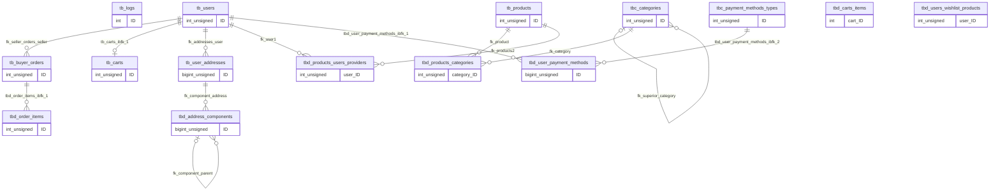

# Diccionario de Datos — `respaldo_2010.sql`

**Base:** `db_test` · **Fecha de documentación:** 20 de octubre de 2026 · **Motor de origen:** MySQL 8.0.36

**Fuente exacta:** `Practica03/backups/Respaldo_2010.sql` (la capitalización real comienza con R).

**SHA-256:** `5f005b0183b18107d8d0a29966ef576f131498e232cda5ff98510583f28d4d49`

## 1. Introducción

Este documento reconstruye la estructura y las dependencias del respaldo. Las definiciones SQL constituyen evidencia confirmada; el propósito comercial y la clasificación de tablas son interpretaciones explícitas, salvo cuando una rutina o restricción los demuestra. No se reproducen filas de datos ni credenciales.

## 2. Objetivo y alcance

Cubrir todas las tablas, columnas, claves, índices, restricciones y objetos programables definidos, incluyendo referencias a objetos ausentes. La cobertura estructural no equivale a resolver toda la semántica comercial ni a verificar el funcionamiento de una restauración.

## 3. Metodología

Se leyó el archivo completo como UTF-8, se calculó su huella y se inspeccionaron definiciones, comentarios ejecutables versionados, delimitadores, objetos y sentencias posteriores. Los INSERT de datos se leyeron como parte del archivo, sin publicarlos ni utilizarlos para asignar significados no demostrados. Un extractor estático separó tipos, defaults, índices y FK; se validó cada línea del cuerpo CREATE TABLE. No se estableció conexión a un servidor ni se ejecutó SQL. Las líneas citadas corresponden al archivo original, contando desde 1.

Los ALTER TABLE del respaldo únicamente habilitan o deshabilitan índices durante la carga; no añaden restricciones. Las vistas provisionales del dump se sustituyen por sus definiciones finales y se cuentan una sola vez. No se detectaron CREATE INDEX independientes, funciones ni eventos definidos. Los SET, LOCK, DROP y controles de sesión se inventarían como instrucciones de restauración, no como entidades.

## 4. Resumen general del esquema

| Indicador | Cantidad / característica |
| --- | --- |
| Esquemas propios | 1: db_test |
| Dependencia externa | mysql.role_edges (sin definición en el dump) |
| Tablas | 15 |
| Columnas | 111 |
| PK | 15 |
| FK | 13 |
| Índices totales (incluyen PK y UNIQUE) | 33 |
| Índices UNIQUE adicionales | 8 |
| Índices ordinarios | 10 |
| CHECK | 3 |
| Triggers | 42 |
| Vistas definitivas | 14 |
| Procedimientos | 1 |
| Funciones / eventos | 0 / 0 |
| Motor / cotejamiento | InnoDB / utf8mb4_0900_ai_ci |
| Columnas NULL / NOT NULL | 24 / 87 |
| Columnas AUTO_INCREMENT | 11 |

## 5. Inventario completo de tablas

| Tabla | Entidad (interpretación) | Tipo (inferido) | Columnas | Línea |
| --- | --- | --- | --- | --- |
| `tb_buyer_orders` | Pedidos desglosados por vendedor | transaccional | 8 | 27 |
| `tb_carts` | Carritos de usuarios | maestra/transaccional | 5 | 169 |
| `tb_logs` | Bitácora general de operaciones | auditoría | 7 | 286 |
| `tb_products` | Productos comercializables | maestra | 9 | 322 |
| `tb_user_addresses` | Direcciones de usuarios | maestra | 12 | 461 |
| `tb_users` | Cuentas de usuarios de la aplicación | maestra | 8 | 718 |
| `tbc_categories` | Categorías jerárquicas de productos | catálogo | 7 | 893 |
| `tbc_payment_methods_types` | Tipos de métodos de pago | catálogo | 6 | 1021 |
| `tbd_address_components` | Componentes jerárquicos de una dirección | detalle | 8 | 1148 |
| `tbd_carts_items` | Artículos de carrito por proveedor y producto | detalle/intermedia lógica | 5 | 1336 |
| `tbd_order_items` | Partidas de pedidos por vendedor | detalle | 8 | 1457 |
| `tbd_products_categories` | Asignación de productos a categorías | intermedia | 5 | 1608 |
| `tbd_products_users_providers` | Vínculos de productos con usuarios proveedores | intermedia | 7 | 1735 |
| `tbd_user_payment_methods` | Instrumentos de pago de usuarios | detalle | 11 | 1910 |
| `tbd_users_wishlist_products` | Productos deseados por usuarios | intermedia lógica | 5 | 2082 |

## 6. Diccionario individual por tabla

Cada tabla incorpora su descripción y diccionario de columnas en la sección 7.

## 7. Descripción detallada de todas las columnas

**Lectura de UNIQUE:** se indican las claves únicas que incluyen cada columna; pertenecer a una clave compuesta no implica unicidad individual. La PK siempre impone unicidad sobre su conjunto. «No declarado» no significa DEFAULT NULL explícito. Los tipos de texto heredan utf8mb4 / utf8mb4_0900_ai_ci salvo cláusula reproducida en el DDL.

### tb_buyer_orders

**Nombre exacto:** `tb_buyer_orders`. **Fuente:** línea 27.

**Descripción general (inferida):** Pedidos desglosados por vendedor.

**Propósito de negocio (inferido):** Dar seguimiento al cumplimiento y a los importes de una parte del pedido asignada a un vendedor. El nombre buyer no determina por sí solo el comprador; la FK apunta al vendedor.

**Propósito técnico:** Mantiene 8 columnas; identifica sus filas mediante `ID`. Conecta las entidades indicadas en las FK siguientes.

**Tipo de tabla (inferido):** transaccional.

**Clave primaria confirmada:** `ID`.

**Relaciones formales:** `tb_buyer_orders` (seller_ID) → `tb_users` (ID), restricción `fk_seller_orders_seller`; `tbd_order_items` (seller_order_ID) → `tb_buyer_orders` (ID), restricción `tbd_order_items_ibfk_1`

**Reglas confirmadas:** PK única y obligatoria; nulabilidad, defaults, generación e índices según el diccionario. No declara CHECK.

**Observaciones técnicas:** La clave sustituta no determina por sí misma la unicidad de atributos de negocio. No se demuestra un nivel formal de normalización ni se conocen todas las validaciones de la aplicación.

| Nombre de columna | Tipo de dato | Permite NULL | PK | FK | UNIQUE (incluye PK) | DEFAULT | AUTO_INCREMENT | Descripción de negocio | Descripción técnica | Restricciones | Referencia |
| --- | --- | --- | --- | --- | --- | --- | --- | --- | --- | --- | --- |
| `ID` | `int unsigned` | No | Sí | No | PRIMARY (ID) | `No declarado` | Sí | Clave que distingue cada fila de pedidos desglosados por vendedor. Interpretación funcional inferida. | Componente de la identidad de tb_buyer_orders; posición 1 en PK; Secuencia numérica generada por MySQL al omitir el identificador. | NOT NULL; PK PRIMARY (ID); UNSIGNED: no admite negativos; no exige valor positivo | Sin FK |
| `order_ID` | `int unsigned` | No | No | No | No | `No declarado` | No | Pedido general al que parece pertenecer el desglose; la entidad de cabecera no está definida y la referencia no está validada por FK. Interpretación funcional inferida. | Atributo de tb_buyer_orders; no participa en una FK declarada. | NOT NULL; UNSIGNED: no admite negativos; no exige valor positivo | Sin FK |
| `seller_ID` | `int unsigned` | No | No | fk_seller_orders_seller | No | `No declarado` | No | Usuario que participa como vendedor del desglose del pedido; la FK no valida un rol comercial. Interpretación funcional inferida. | Integridad referencial por fk_seller_orders_seller. | NOT NULL; UNSIGNED: no admite negativos; no exige valor positivo | tb_users (ID) [tupla completa] |
| `subtotal` | `decimal(12,2)` | No | No | No | No | `'0.00'` | No | Importe parcial del desglose o de la partida; moneda y tratamiento fiscal no determinados. Interpretación funcional inferida. | Decimal exacto: 12 dígitos totales, 2 decimales y 10 enteros; admite signo y no impide negativos salvo CHECK expreso. | NOT NULL | Sin FK |
| `shipping_cost` | `decimal(12,2)` | No | No | No | No | `'0.00'` | No | Costo de envío asignado al desglose por vendedor; moneda no determinada. Interpretación funcional inferida. | Decimal exacto: 12 dígitos totales, 2 decimales y 10 enteros; admite signo y no impide negativos salvo CHECK expreso. | NOT NULL | Sin FK |
| `fulfillment_status` | `enum('Pending','Accepted','Preparing','Sent','Delivered','Canceled','Returned')` | No | No | No | No | `'Pending'` | No | Estado de cumplimiento del pedido por vendedor; los literales constan en el tipo ENUM, sin reglas de transición. Interpretación funcional inferida. | Atributo de tb_buyer_orders; dominio cerrado definido por ENUM. | NOT NULL; Literales permitidos en tipo; comportamiento de valores inválidos depende del SQL_MODE | Sin FK |
| `creation_date` | `datetime` | No | No | No | No | `CURRENT_TIMESTAMP` | No | Momento de creación de la entidad representada por esta tabla. Interpretación funcional inferida. | MySQL asigna CURRENT_TIMESTAMP al omitir el valor; no impide insertar una fecha explícita. | NOT NULL | Sin FK |
| `last_update` | `datetime` | Sí | No | No | No | `NULL` | No | Marca temporal de modificación de la entidad representada por esta tabla. Interpretación funcional inferida. | DEFAULT NULL; ON UPDATE CURRENT_TIMESTAMP actualiza la marca cuando corresponde según cambios de fila; puede suministrarse explícitamente. | Admite NULL | Sin FK |

<details><summary>DDL original de la tabla: evidencia exacta</summary>

```sql
CREATE TABLE `tb_buyer_orders` (
  `ID` int unsigned NOT NULL AUTO_INCREMENT,
  `order_ID` int unsigned NOT NULL,
  `seller_ID` int unsigned NOT NULL,
  `subtotal` decimal(12,2) NOT NULL DEFAULT '0.00',
  `shipping_cost` decimal(12,2) NOT NULL DEFAULT '0.00',
  `fulfillment_status` enum('Pending','Accepted','Preparing','Sent','Delivered','Canceled','Returned') CHARACTER SET utf8mb4 COLLATE utf8mb4_0900_ai_ci NOT NULL DEFAULT 'Pending',
  `creation_date` datetime NOT NULL DEFAULT CURRENT_TIMESTAMP,
  `last_update` datetime DEFAULT NULL ON UPDATE CURRENT_TIMESTAMP,
  PRIMARY KEY (`ID`),
  KEY `fk_seller_orders_seller` (`seller_ID`),
  CONSTRAINT `fk_seller_orders_seller` FOREIGN KEY (`seller_ID`) REFERENCES `tb_users` (`ID`)
) ENGINE=InnoDB DEFAULT CHARSET=utf8mb4 COLLATE=utf8mb4_0900_ai_ci;
```

</details>

### tb_carts

**Nombre exacto:** `tb_carts`. **Fuente:** línea 169.

**Descripción general (inferida):** Carritos de usuarios.

**Propósito de negocio (inferido):** Conservar un carrito por usuario como máximo y servir de cabecera lógica para sus artículos.

**Propósito técnico:** Mantiene 5 columnas; identifica sus filas mediante `ID`. Conecta las entidades indicadas en las FK siguientes.

**Tipo de tabla (inferido):** maestra/transaccional.

**Clave primaria confirmada:** `ID`.

**Relaciones formales:** `tb_carts` (user_ID) → `tb_users` (ID), restricción `tb_carts_ibfk_1`

**Reglas confirmadas:** PK única y obligatoria; nulabilidad, defaults, generación e índices según el diccionario. No declara CHECK.

**Observaciones técnicas:** La clave sustituta no determina por sí misma la unicidad de atributos de negocio. No se demuestra un nivel formal de normalización ni se conocen todas las validaciones de la aplicación.

| Nombre de columna | Tipo de dato | Permite NULL | PK | FK | UNIQUE (incluye PK) | DEFAULT | AUTO_INCREMENT | Descripción de negocio | Descripción técnica | Restricciones | Referencia |
| --- | --- | --- | --- | --- | --- | --- | --- | --- | --- | --- | --- |
| `ID` | `int unsigned` | No | Sí | No | PRIMARY (ID) | `No declarado` | Sí | Clave que distingue cada fila de carritos de usuarios. Interpretación funcional inferida. | Componente de la identidad de tb_carts; posición 1 en PK; Secuencia numérica generada por MySQL al omitir el identificador. | NOT NULL; PK PRIMARY (ID); UNSIGNED: no admite negativos; no exige valor positivo | Sin FK |
| `user_ID` | `int unsigned` | No | No | tb_carts_ibfk_1 | uk_cart_user (user_ID) | `No declarado` | No | Usuario al que pertenece o con el que se asocia la entidad de esta tabla. Interpretación funcional inferida. | Integridad referencial por tb_carts_ibfk_1. | NOT NULL; UNIQUE uk_cart_user (user_ID); UNSIGNED: no admite negativos; no exige valor positivo | tb_users (ID) [tupla completa] |
| `status` | `bit(1)` | Sí | No | No | No | `b'1'` | No | Indicador de estado de la entidad; el significado de sus bits no se generaliza sin evidencia adicional. Interpretación funcional inferida. | BIT(1): un bit, con nulabilidad y default documentados; no se deduce automáticamente un booleano de negocio. | Admite NULL | Sin FK |
| `creation_date` | `datetime` | No | No | No | No | `CURRENT_TIMESTAMP` | No | Momento de creación de la entidad representada por esta tabla. Interpretación funcional inferida. | MySQL asigna CURRENT_TIMESTAMP al omitir el valor; no impide insertar una fecha explícita. | NOT NULL | Sin FK |
| `last_update` | `datetime` | Sí | No | No | No | `NULL` | No | Marca temporal de modificación de la entidad representada por esta tabla. Interpretación funcional inferida. | DEFAULT NULL; ON UPDATE CURRENT_TIMESTAMP actualiza la marca cuando corresponde según cambios de fila; puede suministrarse explícitamente. | Admite NULL | Sin FK |

<details><summary>DDL original de la tabla: evidencia exacta</summary>

```sql
CREATE TABLE `tb_carts` (
  `ID` int unsigned NOT NULL AUTO_INCREMENT,
  `user_ID` int unsigned NOT NULL,
  `status` bit(1) DEFAULT b'1',
  `creation_date` datetime NOT NULL DEFAULT CURRENT_TIMESTAMP,
  `last_update` datetime DEFAULT NULL ON UPDATE CURRENT_TIMESTAMP,
  PRIMARY KEY (`ID`),
  UNIQUE KEY `uk_cart_user` (`user_ID`),
  CONSTRAINT `tb_carts_ibfk_1` FOREIGN KEY (`user_ID`) REFERENCES `tb_users` (`ID`)
) ENGINE=InnoDB DEFAULT CHARSET=utf8mb4 COLLATE=utf8mb4_0900_ai_ci;
```

</details>

### tb_logs

**Nombre exacto:** `tb_logs`. **Fuente:** línea 286.

**Descripción general (inferida):** Bitácora general de operaciones.

**Propósito de negocio (inferido):** Registrar operaciones y la cuenta de conexión que las realizó; soportar las consultas de trazabilidad.

**Propósito técnico:** Mantiene 7 columnas; identifica sus filas mediante `ID`. No declara FK salientes; las relaciones entrantes se indican a continuación.

**Tipo de tabla (inferido):** auditoría.

**Clave primaria confirmada:** `ID`.

**Relaciones formales:** ninguna, ni entrante ni saliente.

**Reglas confirmadas:** PK única y obligatoria; nulabilidad, defaults, generación e índices según el diccionario. No declara CHECK.

**Observaciones técnicas:** La clave sustituta no determina por sí misma la unicidad de atributos de negocio. No se demuestra un nivel formal de normalización ni se conocen todas las validaciones de la aplicación.

| Nombre de columna | Tipo de dato | Permite NULL | PK | FK | UNIQUE (incluye PK) | DEFAULT | AUTO_INCREMENT | Descripción de negocio | Descripción técnica | Restricciones | Referencia |
| --- | --- | --- | --- | --- | --- | --- | --- | --- | --- | --- | --- |
| `ID` | `int` | No | Sí | No | PRIMARY (ID) | `No declarado` | Sí | Clave que distingue cada fila de bitácora general de operaciones. Interpretación funcional inferida. | Componente de la identidad de tb_logs; posición 1 en PK; Secuencia numérica generada por MySQL al omitir el identificador. | NOT NULL; PK PRIMARY (ID) | Sin FK |
| `table_name` | `varchar(100)` | No | No | No | No | `No declarado` | No | Nombre textual de la tabla afectada por la operación de bitácora. Interpretación funcional inferida. | Atributo de tb_logs; no participa en una FK declarada. | NOT NULL | Sin FK |
| `operation` | `enum('Create','Read','Update','Delete')` | No | No | No | No | `No declarado` | No | Clase de operación de bitácora entre Create, Read, Update y Delete; no demuestra que todas sean capturadas automáticamente. Interpretación funcional inferida. | Atributo de tb_logs; dominio cerrado definido por ENUM. | NOT NULL; Literales permitidos en tipo; comportamiento de valores inválidos depende del SQL_MODE | Sin FK |
| `db_users` | `varchar(80)` | No | No | No | No | `No declarado` | No | Cuenta de conexión a MySQL asociada a la operación; distinta de una FK a usuarios de la aplicación. Interpretación funcional inferida. | Atributo de tb_logs; no participa en una FK declarada. | NOT NULL | Sin FK |
| `description` | `text` | No | No | No | No | `No declarado` | No | Texto descriptivo de la operación auditada. Interpretación funcional inferida. | Atributo de tb_logs; no participa en una FK declarada. | NOT NULL | Sin FK |
| `operation_date` | `datetime` | No | No | No | No | `CURRENT_TIMESTAMP` | No | Momento en que se registra la operación en la bitácora. Interpretación funcional inferida. | MySQL asigna CURRENT_TIMESTAMP al omitir el valor; no impide insertar una fecha explícita. | NOT NULL | Sin FK |
| `operation_status` | `bit(1)` | Sí | No | No | No | `b'1'` | No | Indicador asociado al resultado o estado de la operación auditada; convención completa no determinada. Interpretación funcional inferida. | BIT(1): un bit, con nulabilidad y default documentados; no se deduce automáticamente un booleano de negocio. | Admite NULL | Sin FK |

<details><summary>DDL original de la tabla: evidencia exacta</summary>

```sql
CREATE TABLE `tb_logs` (
  `ID` int NOT NULL AUTO_INCREMENT,
  `table_name` varchar(100) CHARACTER SET utf8mb4 COLLATE utf8mb4_0900_ai_ci NOT NULL,
  `operation` enum('Create','Read','Update','Delete') CHARACTER SET utf8mb4 COLLATE utf8mb4_0900_ai_ci NOT NULL,
  `db_users` varchar(80) CHARACTER SET utf8mb4 COLLATE utf8mb4_0900_ai_ci NOT NULL,
  `description` text CHARACTER SET utf8mb4 COLLATE utf8mb4_0900_ai_ci NOT NULL,
  `operation_date` datetime NOT NULL DEFAULT CURRENT_TIMESTAMP,
  `operation_status` bit(1) DEFAULT b'1',
  PRIMARY KEY (`ID`)
) ENGINE=InnoDB AUTO_INCREMENT=43788 DEFAULT CHARSET=utf8mb4 COLLATE=utf8mb4_0900_ai_ci;
```

</details>

### tb_products

**Nombre exacto:** `tb_products`. **Fuente:** línea 322.

**Descripción general (inferida):** Productos comercializables.

**Propósito de negocio (inferido):** Mantener la descripción comercial, SKU, precio y existencias actuales de cada producto.

**Propósito técnico:** Mantiene 9 columnas; identifica sus filas mediante `ID`. No declara FK salientes; las relaciones entrantes se indican a continuación.

**Tipo de tabla (inferido):** maestra.

**Clave primaria confirmada:** `ID`.

**Relaciones formales:** `tbd_products_categories` (product_ID) → `tb_products` (ID), restricción `fk_product`; `tbd_products_users_providers` (product_ID) → `tb_products` (ID), restricción `fk_products2`

**Reglas confirmadas:** PK única y obligatoria; nulabilidad, defaults, generación e índices según el diccionario. No declara CHECK.

**Observaciones técnicas:** La clave sustituta no determina por sí misma la unicidad de atributos de negocio. No se demuestra un nivel formal de normalización ni se conocen todas las validaciones de la aplicación.

| Nombre de columna | Tipo de dato | Permite NULL | PK | FK | UNIQUE (incluye PK) | DEFAULT | AUTO_INCREMENT | Descripción de negocio | Descripción técnica | Restricciones | Referencia |
| --- | --- | --- | --- | --- | --- | --- | --- | --- | --- | --- | --- |
| `ID` | `int unsigned` | No | Sí | No | PRIMARY (ID) | `No declarado` | Sí | Clave que distingue cada fila de productos comercializables. Interpretación funcional inferida. | Componente de la identidad de tb_products; posición 1 en PK; Secuencia numérica generada por MySQL al omitir el identificador. | NOT NULL; PK PRIMARY (ID); UNSIGNED: no admite negativos; no exige valor positivo | Sin FK |
| `SKU` | `varchar(50)` | No | No | No | SKU (SKU) | `No declarado` | No | Código comercial que distingue de forma única cada producto. Interpretación funcional inferida. | Atributo de tb_products; no participa en una FK declarada. | NOT NULL; UNIQUE SKU (SKU) | Sin FK |
| `name` | `varchar(250)` | No | No | No | No | `No declarado` | No | Nombre visible de cada producto comercializable. Interpretación funcional inferida. | Atributo de tb_products; no participa en una FK declarada. | NOT NULL | Sin FK |
| `description` | `text` | Sí | No | No | No | `No declarado` | No | Texto descriptivo de productos comercializables. Interpretación funcional inferida. | Atributo de tb_products; no participa en una FK declarada. | Admite NULL | Sin FK |
| `current_price` | `decimal(10,2)` | No | No | No | No | `'0.00'` | No | Precio actual del producto; moneda, impuestos y vigencia comercial no determinados. Interpretación funcional inferida. | Decimal exacto: 10 dígitos totales, 2 decimales y 8 enteros; admite signo y no impide negativos salvo CHECK expreso. | NOT NULL | Sin FK |
| `current_stock` | `int unsigned` | No | No | No | No | `'0'` | No | Cantidad de existencias actuales del producto; unidad de medida no determinada. Interpretación funcional inferida. | Atributo de tb_products; no participa en una FK declarada. | NOT NULL; UNSIGNED: no admite negativos; no exige valor positivo | Sin FK |
| `status` | `bit(1)` | Sí | No | No | No | `b'1'` | No | Indicador de estado de la entidad; el significado de sus bits no se generaliza sin evidencia adicional. Interpretación funcional inferida. | BIT(1): un bit, con nulabilidad y default documentados; no se deduce automáticamente un booleano de negocio. | Admite NULL | Sin FK |
| `creation_date` | `datetime` | No | No | No | No | `CURRENT_TIMESTAMP` | No | Momento de creación de la entidad representada por esta tabla. Interpretación funcional inferida. | MySQL asigna CURRENT_TIMESTAMP al omitir el valor; no impide insertar una fecha explícita. | NOT NULL | Sin FK |
| `last_update` | `datetime` | No | No | No | No | `No declarado` | No | Marca temporal de modificación de la entidad representada por esta tabla. Interpretación funcional inferida. | Sin DEFAULT explícito; no asumir inicialización automática al insertar; ON UPDATE CURRENT_TIMESTAMP actualiza la marca cuando corresponde según cambios de fila; puede suministrarse explícitamente. | NOT NULL | Sin FK |

<details><summary>DDL original de la tabla: evidencia exacta</summary>

```sql
CREATE TABLE `tb_products` (
  `ID` int unsigned NOT NULL AUTO_INCREMENT,
  `SKU` varchar(50) CHARACTER SET utf8mb4 COLLATE utf8mb4_0900_ai_ci NOT NULL,
  `name` varchar(250) CHARACTER SET utf8mb4 COLLATE utf8mb4_0900_ai_ci NOT NULL,
  `description` text CHARACTER SET utf8mb4 COLLATE utf8mb4_0900_ai_ci,
  `current_price` decimal(10,2) NOT NULL DEFAULT '0.00',
  `current_stock` int unsigned NOT NULL DEFAULT '0',
  `status` bit(1) DEFAULT b'1',
  `creation_date` datetime NOT NULL DEFAULT CURRENT_TIMESTAMP,
  `last_update` datetime NOT NULL ON UPDATE CURRENT_TIMESTAMP,
  PRIMARY KEY (`ID`),
  UNIQUE KEY `SKU` (`SKU`)
) ENGINE=InnoDB AUTO_INCREMENT=24585 DEFAULT CHARSET=utf8mb4 COLLATE=utf8mb4_0900_ai_ci;
```

</details>

### tb_user_addresses

**Nombre exacto:** `tb_user_addresses`. **Fuente:** línea 461.

**Descripción general (inferida):** Direcciones de usuarios.

**Propósito de negocio (inferido):** Administrar destinos de entrega, destinatario y coordenadas asociados a una cuenta.

**Propósito técnico:** Mantiene 12 columnas; identifica sus filas mediante `ID`. Conecta las entidades indicadas en las FK siguientes.

**Tipo de tabla (inferido):** maestra.

**Clave primaria confirmada:** `ID`.

**Relaciones formales:** `tb_user_addresses` (user_ID) → `tb_users` (ID), restricción `fk_addresses_user`; `tbd_address_components` (address_ID) → `tb_user_addresses` (ID), restricción `fk_component_address`

**Reglas confirmadas:** PK única y obligatoria; nulabilidad, defaults, generación e índices según el diccionario. CONSTRAINT `chk_coordinates` CHECK ((((`latitude` is null) and (`longitude` is null)) or ((`latitude` is not null) and (`longitude` is not null)))) CONSTRAINT `chk_latitude` CHECK ((`latitude` between -(90) and 90)) CONSTRAINT `chk_longitude` CHECK ((`longitude` between -(180) and 180))

**Observaciones técnicas:** La clave sustituta no determina por sí misma la unicidad de atributos de negocio. No se demuestra un nivel formal de normalización ni se conocen todas las validaciones de la aplicación.

| Nombre de columna | Tipo de dato | Permite NULL | PK | FK | UNIQUE (incluye PK) | DEFAULT | AUTO_INCREMENT | Descripción de negocio | Descripción técnica | Restricciones | Referencia |
| --- | --- | --- | --- | --- | --- | --- | --- | --- | --- | --- | --- |
| `ID` | `bigint unsigned` | No | Sí | No | PRIMARY (ID) | `No declarado` | Sí | Clave que distingue cada fila de direcciones de usuarios. Interpretación funcional inferida. | Componente de la identidad de tb_user_addresses; posición 1 en PK; Secuencia numérica generada por MySQL al omitir el identificador. | NOT NULL; PK PRIMARY (ID); UNSIGNED: no admite negativos; no exige valor positivo | Sin FK |
| `user_ID` | `int unsigned` | No | No | fk_addresses_user | No | `No declarado` | No | Usuario al que pertenece o con el que se asocia la entidad de esta tabla. Interpretación funcional inferida. | Integridad referencial por fk_addresses_user. | NOT NULL; UNSIGNED: no admite negativos; no exige valor positivo | tb_users (ID) [tupla completa] |
| `address_label` | `varchar(100)` | No | No | No | No | `No declarado` | No | Etiqueta reconocible por el usuario para distinguir una dirección. Interpretación funcional inferida. | Atributo de tb_user_addresses; no participa en una FK declarada. | NOT NULL | Sin FK |
| `recipient_name` | `varchar(150)` | Sí | No | No | No | `NULL` | No | Nombre del destinatario de la entrega en esta dirección. Interpretación funcional inferida. | Atributo de tb_user_addresses; no participa en una FK declarada. | Admite NULL | Sin FK |
| `recipient_phone` | `varchar(25)` | Sí | No | No | No | `NULL` | No | Teléfono de contacto del destinatario; se conserva como texto sin validación de formato. Interpretación funcional inferida. | Atributo de tb_user_addresses; no participa en una FK declarada. | Admite NULL | Sin FK |
| `delivery_instructions` | `varchar(500)` | Sí | No | No | No | `NULL` | No | Indicaciones de entrega asociadas a la dirección. Interpretación funcional inferida. | Atributo de tb_user_addresses; no participa en una FK declarada. | Admite NULL | Sin FK |
| `latitude` | `decimal(10,7)` | Sí | No | No | No | `NULL` | No | Coordenada de latitud de la dirección, limitada entre -90 y 90. Interpretación funcional inferida. | Decimal exacto: 10 dígitos totales, 7 decimales y 3 enteros; admite signo y no impide negativos salvo CHECK expreso. | Admite NULL; CONSTRAINT `chk_coordinates` CHECK ((((`latitude` is null) and (`longitude` is null)) or ((`latitude` is not null) and (`longitude` is not null)))); CONSTRAINT `chk_latitude` CHECK ((`latitude` between -(90) and 90)) | Sin FK |
| `longitude` | `decimal(10,7)` | Sí | No | No | No | `NULL` | No | Coordenada de longitud de la dirección, limitada entre -180 y 180. Interpretación funcional inferida. | Decimal exacto: 10 dígitos totales, 7 decimales y 3 enteros; admite signo y no impide negativos salvo CHECK expreso. | Admite NULL; CONSTRAINT `chk_coordinates` CHECK ((((`latitude` is null) and (`longitude` is null)) or ((`latitude` is not null) and (`longitude` is not null)))); CONSTRAINT `chk_longitude` CHECK ((`longitude` between -(180) and 180)) | Sin FK |
| `is_default` | `tinyint(1)` | No | No | No | No | `'0'` | No | Indicador propuesto de selección predeterminada de dirección o método de pago; 0 y 1 no están limitados mediante CHECK. Interpretación funcional inferida. | Entero con DEFAULT 0; no hay unicidad condicional por usuario ni CHECK que lo restrinja a 0/1. | NOT NULL | Sin FK |
| `status` | `bit(1)` | No | No | No | No | `b'1'` | No | Indicador de estado de la entidad; el significado de sus bits no se generaliza sin evidencia adicional. Interpretación funcional inferida. | BIT(1): un bit, con nulabilidad y default documentados; no se deduce automáticamente un booleano de negocio. | NOT NULL | Sin FK |
| `creation_date` | `datetime` | No | No | No | No | `CURRENT_TIMESTAMP` | No | Momento de creación de la entidad representada por esta tabla. Interpretación funcional inferida. | MySQL asigna CURRENT_TIMESTAMP al omitir el valor; no impide insertar una fecha explícita. | NOT NULL | Sin FK |
| `last_update` | `datetime` | Sí | No | No | No | `NULL` | No | Marca temporal de modificación de la entidad representada por esta tabla. Interpretación funcional inferida. | DEFAULT NULL; ON UPDATE CURRENT_TIMESTAMP actualiza la marca cuando corresponde según cambios de fila; puede suministrarse explícitamente. | Admite NULL | Sin FK |

<details><summary>DDL original de la tabla: evidencia exacta</summary>

```sql
CREATE TABLE `tb_user_addresses` (
  `ID` bigint unsigned NOT NULL AUTO_INCREMENT,
  `user_ID` int unsigned NOT NULL,
  `address_label` varchar(100) NOT NULL,
  `recipient_name` varchar(150) DEFAULT NULL,
  `recipient_phone` varchar(25) DEFAULT NULL,
  `delivery_instructions` varchar(500) DEFAULT NULL,
  `latitude` decimal(10,7) DEFAULT NULL,
  `longitude` decimal(10,7) DEFAULT NULL,
  `is_default` tinyint(1) NOT NULL DEFAULT '0',
  `status` bit(1) NOT NULL DEFAULT b'1',
  `creation_date` datetime NOT NULL DEFAULT CURRENT_TIMESTAMP,
  `last_update` datetime DEFAULT NULL ON UPDATE CURRENT_TIMESTAMP,
  PRIMARY KEY (`ID`),
  KEY `idx_user_addresses` (`user_ID`),
  CONSTRAINT `fk_addresses_user` FOREIGN KEY (`user_ID`) REFERENCES `tb_users` (`ID`),
  CONSTRAINT `chk_coordinates` CHECK ((((`latitude` is null) and (`longitude` is null)) or ((`latitude` is not null) and (`longitude` is not null)))),
  CONSTRAINT `chk_latitude` CHECK ((`latitude` between -(90) and 90)),
  CONSTRAINT `chk_longitude` CHECK ((`longitude` between -(180) and 180))
) ENGINE=InnoDB DEFAULT CHARSET=utf8mb4 COLLATE=utf8mb4_0900_ai_ci;
```

</details>

### tb_users

**Nombre exacto:** `tb_users`. **Fuente:** línea 718.

**Descripción general (inferida):** Cuentas de usuarios de la aplicación.

**Propósito de negocio (inferido):** Mantener identidad de acceso y estado de cuentas que participan en carritos, direcciones y provisión de productos.

**Propósito técnico:** Mantiene 8 columnas; identifica sus filas mediante `ID`. No declara FK salientes; las relaciones entrantes se indican a continuación.

**Tipo de tabla (inferido):** maestra.

**Clave primaria confirmada:** `ID`.

**Relaciones formales:** `tb_buyer_orders` (seller_ID) → `tb_users` (ID), restricción `fk_seller_orders_seller`; `tb_carts` (user_ID) → `tb_users` (ID), restricción `tb_carts_ibfk_1`; `tb_user_addresses` (user_ID) → `tb_users` (ID), restricción `fk_addresses_user`; `tbd_products_users_providers` (user_ID) → `tb_users` (ID), restricción `fk_user1`; `tbd_user_payment_methods` (user_ID) → `tb_users` (ID), restricción `tbd_user_payment_methods_ibfk_1`

**Reglas confirmadas:** PK única y obligatoria; nulabilidad, defaults, generación e índices según el diccionario. No declara CHECK.

**Observaciones técnicas:** La clave sustituta no determina por sí misma la unicidad de atributos de negocio. No se demuestra un nivel formal de normalización ni se conocen todas las validaciones de la aplicación.

| Nombre de columna | Tipo de dato | Permite NULL | PK | FK | UNIQUE (incluye PK) | DEFAULT | AUTO_INCREMENT | Descripción de negocio | Descripción técnica | Restricciones | Referencia |
| --- | --- | --- | --- | --- | --- | --- | --- | --- | --- | --- | --- |
| `ID` | `int unsigned` | No | Sí | No | PRIMARY (ID) | `No declarado` | Sí | Clave que distingue cada fila de cuentas de usuarios de la aplicación. Interpretación funcional inferida. | Componente de la identidad de tb_users; posición 1 en PK; Secuencia numérica generada por MySQL al omitir el identificador. | NOT NULL; PK PRIMARY (ID); UNSIGNED: no admite negativos; no exige valor positivo | Sin FK |
| `email` | `varchar(80)` | No | No | No | email (email) | `No declarado` | No | Dirección de correo utilizada para distinguir la cuenta de usuario; no se valida su sintaxis. Interpretación funcional inferida. | Atributo de tb_users; no participa en una FK declarada. | NOT NULL; UNIQUE email (email) | Sin FK |
| `nick` | `varchar(100)` | No | No | No | nickname (nick) | `No declarado` | No | Alias único de la cuenta de usuario. Interpretación funcional inferida. | Atributo de tb_users; no participa en una FK declarada. | NOT NULL; UNIQUE nickname (nick) | Sin FK |
| `password` | `varchar(255)` | No | No | No | No | `No declarado` | No | Representación de la credencial de acceso de la cuenta; el SQL no determina algoritmo de hash ni cifrado. Interpretación funcional inferida. | Atributo de tb_users; no participa en una FK declarada. | NOT NULL | Sin FK |
| `creation_date` | `datetime` | No | No | No | No | `CURRENT_TIMESTAMP` | No | Momento de creación de la entidad representada por esta tabla. Interpretación funcional inferida. | MySQL asigna CURRENT_TIMESTAMP al omitir el valor; no impide insertar una fecha explícita. | NOT NULL | Sin FK |
| `last_update` | `datetime` | Sí | No | No | No | `CURRENT_TIMESTAMP` | No | Marca temporal de modificación de la entidad representada por esta tabla. Interpretación funcional inferida. | DEFAULT CURRENT_TIMESTAMP; ON UPDATE CURRENT_TIMESTAMP actualiza la marca cuando corresponde según cambios de fila; puede suministrarse explícitamente. | Admite NULL | Sin FK |
| `last_login` | `datetime` | Sí | No | No | No | `NULL` | No | Momento registrado del último acceso de la cuenta; no hay actualización automática declarada. Interpretación funcional inferida. | Atributo de tb_users; no participa en una FK declarada. | Admite NULL | Sin FK |
| `status` | `bit(1)` | No | No | No | No | `b'1'` | No | Estado de la cuenta: sp_soft_delete_user utiliza 0 para inactivo y cambia 1 a 0; esta interpretación está respaldada por el procedimiento.  | BIT(1): un bit, con nulabilidad y default documentados; no se deduce automáticamente un booleano de negocio. | NOT NULL | Sin FK |

<details><summary>DDL original de la tabla: evidencia exacta</summary>

```sql
CREATE TABLE `tb_users` (
  `ID` int unsigned NOT NULL AUTO_INCREMENT,
  `email` varchar(80) CHARACTER SET utf8mb4 COLLATE utf8mb4_0900_ai_ci NOT NULL,
  `nick` varchar(100) CHARACTER SET utf8mb4 COLLATE utf8mb4_0900_ai_ci NOT NULL,
  `password` varchar(255) CHARACTER SET utf8mb4 COLLATE utf8mb4_0900_ai_ci NOT NULL,
  `creation_date` datetime NOT NULL DEFAULT CURRENT_TIMESTAMP,
  `last_update` datetime DEFAULT CURRENT_TIMESTAMP ON UPDATE CURRENT_TIMESTAMP,
  `last_login` datetime DEFAULT NULL,
  `status` bit(1) NOT NULL DEFAULT b'1',
  PRIMARY KEY (`ID`),
  UNIQUE KEY `email` (`email`),
  UNIQUE KEY `nickname` (`nick`)
) ENGINE=InnoDB AUTO_INCREMENT=19 DEFAULT CHARSET=utf8mb4 COLLATE=utf8mb4_0900_ai_ci;
```

</details>

### tbc_categories

**Nombre exacto:** `tbc_categories`. **Fuente:** línea 893.

**Descripción general (inferida):** Categorías jerárquicas de productos.

**Propósito de negocio (inferido):** Organizar productos en categorías con una categoría superior opcional.

**Propósito técnico:** Mantiene 7 columnas; identifica sus filas mediante `ID`. Conecta las entidades indicadas en las FK siguientes.

**Tipo de tabla (inferido):** catálogo.

**Clave primaria confirmada:** `ID`.

**Relaciones formales:** `tbc_categories` (sup_id_category) → `tbc_categories` (ID), restricción `fk_superior_category`; `tbd_products_categories` (category_ID) → `tbc_categories` (ID), restricción `fk_category`

**Reglas confirmadas:** PK única y obligatoria; nulabilidad, defaults, generación e índices según el diccionario. No declara CHECK.

**Observaciones técnicas:** La clave sustituta no determina por sí misma la unicidad de atributos de negocio. No se demuestra un nivel formal de normalización ni se conocen todas las validaciones de la aplicación.

| Nombre de columna | Tipo de dato | Permite NULL | PK | FK | UNIQUE (incluye PK) | DEFAULT | AUTO_INCREMENT | Descripción de negocio | Descripción técnica | Restricciones | Referencia |
| --- | --- | --- | --- | --- | --- | --- | --- | --- | --- | --- | --- |
| `ID` | `int unsigned` | No | Sí | No | PRIMARY (ID) | `No declarado` | Sí | Clave que distingue cada fila de categorías jerárquicas de productos. Interpretación funcional inferida. | Componente de la identidad de tbc_categories; posición 1 en PK; Secuencia numérica generada por MySQL al omitir el identificador. | NOT NULL; PK PRIMARY (ID); UNSIGNED: no admite negativos; no exige valor positivo | Sin FK |
| `name` | `varchar(120)` | No | No | No | name (name) | `No declarado` | No | Nombre visible de la categoría de productos. Interpretación funcional inferida. | Atributo de tbc_categories; no participa en una FK declarada. | NOT NULL; UNIQUE name (name) | Sin FK |
| `description` | `text` | Sí | No | No | No | `No declarado` | No | Texto descriptivo de categorías jerárquicas de productos. Interpretación funcional inferida. | Atributo de tbc_categories; no participa en una FK declarada. | Admite NULL | Sin FK |
| `sup_id_category` | `int unsigned` | Sí | No | fk_superior_category | No | `NULL` | No | Categoría superior opcional que estructura la jerarquía del catálogo. Interpretación funcional inferida. | Integridad referencial por fk_superior_category. | Admite NULL; UNSIGNED: no admite negativos; no exige valor positivo | tbc_categories (ID) [tupla completa] |
| `status` | `bit(1)` | No | No | No | No | `b'1'` | No | Indicador de estado de la entidad; el significado de sus bits no se generaliza sin evidencia adicional. Interpretación funcional inferida. | BIT(1): un bit, con nulabilidad y default documentados; no se deduce automáticamente un booleano de negocio. | NOT NULL | Sin FK |
| `creation_date` | `datetime` | No | No | No | No | `CURRENT_TIMESTAMP` | No | Momento de creación de la entidad representada por esta tabla. Interpretación funcional inferida. | MySQL asigna CURRENT_TIMESTAMP al omitir el valor; no impide insertar una fecha explícita. | NOT NULL | Sin FK |
| `last_update` | `datetime` | No | No | No | No | `No declarado` | No | Marca temporal de modificación de la entidad representada por esta tabla. Interpretación funcional inferida. | Sin DEFAULT explícito; no asumir inicialización automática al insertar; ON UPDATE CURRENT_TIMESTAMP actualiza la marca cuando corresponde según cambios de fila; puede suministrarse explícitamente. | NOT NULL | Sin FK |

<details><summary>DDL original de la tabla: evidencia exacta</summary>

```sql
CREATE TABLE `tbc_categories` (
  `ID` int unsigned NOT NULL AUTO_INCREMENT,
  `name` varchar(120) CHARACTER SET utf8mb4 COLLATE utf8mb4_0900_ai_ci NOT NULL,
  `description` text CHARACTER SET utf8mb4 COLLATE utf8mb4_0900_ai_ci,
  `sup_id_category` int unsigned DEFAULT NULL,
  `status` bit(1) NOT NULL DEFAULT b'1',
  `creation_date` datetime NOT NULL DEFAULT CURRENT_TIMESTAMP,
  `last_update` datetime NOT NULL ON UPDATE CURRENT_TIMESTAMP,
  PRIMARY KEY (`ID`),
  UNIQUE KEY `name` (`name`),
  KEY `fk_superior_category` (`sup_id_category`),
  CONSTRAINT `fk_superior_category` FOREIGN KEY (`sup_id_category`) REFERENCES `tbc_categories` (`ID`)
) ENGINE=InnoDB AUTO_INCREMENT=101 DEFAULT CHARSET=utf8mb4 COLLATE=utf8mb4_0900_ai_ci;
```

</details>

### tbc_payment_methods_types

**Nombre exacto:** `tbc_payment_methods_types`. **Fuente:** línea 1021.

**Descripción general (inferida):** Tipos de métodos de pago.

**Propósito de negocio (inferido):** Clasificar los instrumentos de pago registrados por los usuarios mediante códigos únicos.

**Propósito técnico:** Mantiene 6 columnas; identifica sus filas mediante `ID`. No declara FK salientes; las relaciones entrantes se indican a continuación.

**Tipo de tabla (inferido):** catálogo.

**Clave primaria confirmada:** `ID`.

**Relaciones formales:** `tbd_user_payment_methods` (payment_method_type_ID) → `tbc_payment_methods_types` (ID), restricción `tbd_user_payment_methods_ibfk_2`

**Reglas confirmadas:** PK única y obligatoria; nulabilidad, defaults, generación e índices según el diccionario. No declara CHECK.

**Observaciones técnicas:** La clave sustituta no determina por sí misma la unicidad de atributos de negocio. No se demuestra un nivel formal de normalización ni se conocen todas las validaciones de la aplicación.

| Nombre de columna | Tipo de dato | Permite NULL | PK | FK | UNIQUE (incluye PK) | DEFAULT | AUTO_INCREMENT | Descripción de negocio | Descripción técnica | Restricciones | Referencia |
| --- | --- | --- | --- | --- | --- | --- | --- | --- | --- | --- | --- |
| `ID` | `int unsigned` | No | Sí | No | PRIMARY (ID) | `No declarado` | Sí | Clave que distingue cada fila de tipos de métodos de pago. Interpretación funcional inferida. | Componente de la identidad de tbc_payment_methods_types; posición 1 en PK; Secuencia numérica generada por MySQL al omitir el identificador. | NOT NULL; PK PRIMARY (ID); UNSIGNED: no admite negativos; no exige valor positivo | Sin FK |
| `code` | `varchar(30)` | No | No | No | code_UNIQUE (code) | `No declarado` | No | Código único que identifica un tipo de método de pago. Interpretación funcional inferida. | Atributo de tbc_payment_methods_types; no participa en una FK declarada. | NOT NULL; UNIQUE code_UNIQUE (code) | Sin FK |
| `description` | `text` | No | No | No | No | `No declarado` | No | Texto descriptivo de tipos de métodos de pago. Interpretación funcional inferida. | Atributo de tbc_payment_methods_types; no participa en una FK declarada. | NOT NULL | Sin FK |
| `status` | `bit(1)` | No | No | No | No | `b'1'` | No | Indicador de estado de la entidad; el significado de sus bits no se generaliza sin evidencia adicional. Interpretación funcional inferida. | BIT(1): un bit, con nulabilidad y default documentados; no se deduce automáticamente un booleano de negocio. | NOT NULL | Sin FK |
| `creation_date` | `datetime` | No | No | No | No | `CURRENT_TIMESTAMP` | No | Momento de creación de la entidad representada por esta tabla. Interpretación funcional inferida. | MySQL asigna CURRENT_TIMESTAMP al omitir el valor; no impide insertar una fecha explícita. | NOT NULL | Sin FK |
| `last_update` | `datetime` | Sí | No | No | No | `NULL` | No | Marca temporal de modificación de la entidad representada por esta tabla. Interpretación funcional inferida. | DEFAULT NULL; ON UPDATE CURRENT_TIMESTAMP actualiza la marca cuando corresponde según cambios de fila; puede suministrarse explícitamente. | Admite NULL | Sin FK |

<details><summary>DDL original de la tabla: evidencia exacta</summary>

```sql
CREATE TABLE `tbc_payment_methods_types` (
  `ID` int unsigned NOT NULL AUTO_INCREMENT,
  `code` varchar(30) NOT NULL,
  `description` text NOT NULL,
  `status` bit(1) NOT NULL DEFAULT b'1',
  `creation_date` datetime NOT NULL DEFAULT CURRENT_TIMESTAMP,
  `last_update` datetime DEFAULT NULL ON UPDATE CURRENT_TIMESTAMP,
  PRIMARY KEY (`ID`),
  UNIQUE KEY `code_UNIQUE` (`code`)
) ENGINE=InnoDB DEFAULT CHARSET=utf8mb4 COLLATE=utf8mb4_0900_ai_ci;
```

</details>

### tbd_address_components

**Nombre exacto:** `tbd_address_components`. **Fuente:** línea 1148.

**Descripción general (inferida):** Componentes jerárquicos de una dirección.

**Propósito de negocio (inferido):** Descomponer direcciones en componentes tipificados y organizar su jerarquía dentro de la misma dirección.

**Propósito técnico:** Mantiene 8 columnas; identifica sus filas mediante `ID`. Conecta las entidades indicadas en las FK siguientes.

**Tipo de tabla (inferido):** detalle.

**Clave primaria confirmada:** `ID`.

**Relaciones formales:** `tbd_address_components` (address_ID) → `tb_user_addresses` (ID), restricción `fk_component_address`; `tbd_address_components` (address_ID, address_sup_ID) → `tbd_address_components` (address_ID, ID), restricción `fk_component_parent`

**Reglas confirmadas:** PK única y obligatoria; nulabilidad, defaults, generación e índices según el diccionario. No declara CHECK.

**Observaciones técnicas:** La clave sustituta no determina por sí misma la unicidad de atributos de negocio. No se demuestra un nivel formal de normalización ni se conocen todas las validaciones de la aplicación.

| Nombre de columna | Tipo de dato | Permite NULL | PK | FK | UNIQUE (incluye PK) | DEFAULT | AUTO_INCREMENT | Descripción de negocio | Descripción técnica | Restricciones | Referencia |
| --- | --- | --- | --- | --- | --- | --- | --- | --- | --- | --- | --- |
| `ID` | `bigint unsigned` | No | Sí | No | PRIMARY (ID); uk_address_component (address_ID, ID) | `No declarado` | Sí | Clave que distingue cada fila de componentes jerárquicos de una dirección. Interpretación funcional inferida. | Componente de la identidad de tbd_address_components; posición 1 en PK; Secuencia numérica generada por MySQL al omitir el identificador. | NOT NULL; PK PRIMARY (ID); UNIQUE uk_address_component (address_ID, ID); UNSIGNED: no admite negativos; no exige valor positivo | Sin FK |
| `address_ID` | `bigint unsigned` | No | No | fk_component_address, fk_component_parent | uk_address_component (address_ID, ID) | `No declarado` | No | Dirección a la que pertenece el componente. Interpretación funcional inferida. | Integridad referencial por fk_component_address, fk_component_parent. | NOT NULL; UNIQUE uk_address_component (address_ID, ID); UNSIGNED: no admite negativos; no exige valor positivo | tb_user_addresses (ID) [tupla completa]; tbd_address_components (address_ID, ID) [tupla completa] |
| `value` | `varchar(255)` | No | No | No | No | `No declarado` | No | Contenido textual del componente de dirección; significado concreto depende de component_type. Interpretación funcional inferida. | Atributo de tbd_address_components; no participa en una FK declarada. | NOT NULL | Sin FK |
| `component_type` | `varchar(50)` | No | No | No | No | `No declarado` | No | Nombre del tipo de componente de dirección; sin catálogo ni enumeración de valores autorizados. Interpretación funcional inferida. | Atributo de tbd_address_components; no participa en una FK declarada. | NOT NULL | Sin FK |
| `status` | `bit(1)` | No | No | No | No | `b'1'` | No | Indicador de estado de la entidad; el significado de sus bits no se generaliza sin evidencia adicional. Interpretación funcional inferida. | BIT(1): un bit, con nulabilidad y default documentados; no se deduce automáticamente un booleano de negocio. | NOT NULL | Sin FK |
| `address_sup_ID` | `bigint unsigned` | Sí | No | fk_component_parent | No | `NULL` | No | Componente superior opcional dentro de la misma dirección. Interpretación funcional inferida. | Integridad referencial por fk_component_parent. | Admite NULL; UNSIGNED: no admite negativos; no exige valor positivo | tbd_address_components (address_ID, ID) [tupla completa] |
| `creation_date` | `datetime` | No | No | No | No | `CURRENT_TIMESTAMP` | No | Momento de creación de la entidad representada por esta tabla. Interpretación funcional inferida. | MySQL asigna CURRENT_TIMESTAMP al omitir el valor; no impide insertar una fecha explícita. | NOT NULL | Sin FK |
| `last_update` | `datetime` | Sí | No | No | No | `NULL` | No | Marca temporal de modificación de la entidad representada por esta tabla. Interpretación funcional inferida. | DEFAULT NULL; ON UPDATE CURRENT_TIMESTAMP actualiza la marca cuando corresponde según cambios de fila; puede suministrarse explícitamente. | Admite NULL | Sin FK |

<details><summary>DDL original de la tabla: evidencia exacta</summary>

```sql
CREATE TABLE `tbd_address_components` (
  `ID` bigint unsigned NOT NULL AUTO_INCREMENT,
  `address_ID` bigint unsigned NOT NULL,
  `value` varchar(255) NOT NULL,
  `component_type` varchar(50) NOT NULL,
  `status` bit(1) NOT NULL DEFAULT b'1',
  `address_sup_ID` bigint unsigned DEFAULT NULL,
  `creation_date` datetime NOT NULL DEFAULT CURRENT_TIMESTAMP,
  `last_update` datetime DEFAULT NULL ON UPDATE CURRENT_TIMESTAMP,
  PRIMARY KEY (`ID`),
  UNIQUE KEY `uk_address_component` (`address_ID`,`ID`),
  KEY `idx_address_parent` (`address_ID`,`address_sup_ID`),
  CONSTRAINT `fk_component_address` FOREIGN KEY (`address_ID`) REFERENCES `tb_user_addresses` (`ID`) ON DELETE RESTRICT,
  CONSTRAINT `fk_component_parent` FOREIGN KEY (`address_ID`, `address_sup_ID`) REFERENCES `tbd_address_components` (`address_ID`, `ID`) ON DELETE RESTRICT
) ENGINE=InnoDB DEFAULT CHARSET=utf8mb4 COLLATE=utf8mb4_0900_ai_ci;
```

</details>

### tbd_carts_items

**Nombre exacto:** `tbd_carts_items`. **Fuente:** línea 1336.

**Descripción general (inferida):** Artículos de carrito por proveedor y producto.

**Propósito de negocio (inferido):** Representar la cantidad seleccionada de un producto ofrecido por un proveedor dentro de un carrito; no existen FK que aseguren esa interpretación.

**Propósito técnico:** Mantiene 5 columnas; identifica sus filas mediante `cart_ID, provider_ID, product_ID`. No declara FK salientes; las relaciones entrantes se indican a continuación.

**Tipo de tabla (inferido):** detalle/intermedia lógica.

**Clave primaria confirmada:** `cart_ID, provider_ID, product_ID`.

**Relaciones formales:** ninguna, ni entrante ni saliente.

**Reglas confirmadas:** PK única y obligatoria; nulabilidad, defaults, generación e índices según el diccionario. No declara CHECK.

**Observaciones técnicas:** La PK compuesta impide repetir la combinación completa; no asegura unicidad de sus componentes por separado. No se declara integridad referencial para los identificadores lógicos de esta tabla. No se demuestra un nivel formal de normalización ni se conocen todas las validaciones de la aplicación.

| Nombre de columna | Tipo de dato | Permite NULL | PK | FK | UNIQUE (incluye PK) | DEFAULT | AUTO_INCREMENT | Descripción de negocio | Descripción técnica | Restricciones | Referencia |
| --- | --- | --- | --- | --- | --- | --- | --- | --- | --- | --- | --- |
| `cart_ID` | `int` | No | Sí | No | PRIMARY (cart_ID, provider_ID, product_ID) | `No declarado` | No | Carrito al que parece pertenecer la selección de producto; sin FK. Interpretación funcional inferida. | Componente de la identidad de tbd_carts_items; posición 1 en PK. | NOT NULL; PK PRIMARY (cart_ID, provider_ID, product_ID) | Sin FK |
| `provider_ID` | `int` | No | Sí | No | PRIMARY (cart_ID, provider_ID, product_ID) | `No declarado` | No | Proveedor asociado a la selección del carrito; su correspondencia con tb_users es inferida. Interpretación funcional inferida. | Componente de la identidad de tbd_carts_items; posición 2 en PK. | NOT NULL; PK PRIMARY (cart_ID, provider_ID, product_ID) | Sin FK |
| `product_ID` | `int` | No | Sí | No | PRIMARY (cart_ID, provider_ID, product_ID) | `No declarado` | No | Producto incluido en la asociación o selección representada por esta tabla. Interpretación funcional inferida. | Componente de la identidad de tbd_carts_items; posición 3 en PK. | NOT NULL; PK PRIMARY (cart_ID, provider_ID, product_ID) | Sin FK |
| `quantity` | `int` | No | No | No | No | `No declarado` | No | Cantidad de unidades del producto incluidas en el carrito o partida. Interpretación funcional inferida. | Atributo de tbd_carts_items; no participa en una FK declarada. | NOT NULL | Sin FK |
| `creation_date` | `datetime` | No | No | No | No | `CURRENT_TIMESTAMP` | No | Momento de creación de la entidad representada por esta tabla. Interpretación funcional inferida. | MySQL asigna CURRENT_TIMESTAMP al omitir el valor; no impide insertar una fecha explícita. | NOT NULL | Sin FK |

<details><summary>DDL original de la tabla: evidencia exacta</summary>

```sql
CREATE TABLE `tbd_carts_items` (
  `cart_ID` int NOT NULL,
  `provider_ID` int NOT NULL,
  `product_ID` int NOT NULL,
  `quantity` int NOT NULL,
  `creation_date` datetime NOT NULL DEFAULT CURRENT_TIMESTAMP,
  PRIMARY KEY (`cart_ID`,`provider_ID`,`product_ID`)
) ENGINE=InnoDB DEFAULT CHARSET=utf8mb4 COLLATE=utf8mb4_0900_ai_ci;
```

</details>

### tbd_order_items

**Nombre exacto:** `tbd_order_items`. **Fuente:** línea 1457.

**Descripción general (inferida):** Partidas de pedidos por vendedor.

**Propósito de negocio (inferido):** Conservar cantidades, nombre de producto y precio unitario de las partidas y calcular su subtotal.

**Propósito técnico:** Mantiene 8 columnas; identifica sus filas mediante `ID`. Conecta las entidades indicadas en las FK siguientes.

**Tipo de tabla (inferido):** detalle.

**Clave primaria confirmada:** `ID`.

**Relaciones formales:** `tbd_order_items` (seller_order_ID) → `tb_buyer_orders` (ID), restricción `tbd_order_items_ibfk_1`

**Reglas confirmadas:** PK única y obligatoria; nulabilidad, defaults, generación e índices según el diccionario. No declara CHECK.

**Observaciones técnicas:** La clave sustituta no determina por sí misma la unicidad de atributos de negocio. No se demuestra un nivel formal de normalización ni se conocen todas las validaciones de la aplicación.

| Nombre de columna | Tipo de dato | Permite NULL | PK | FK | UNIQUE (incluye PK) | DEFAULT | AUTO_INCREMENT | Descripción de negocio | Descripción técnica | Restricciones | Referencia |
| --- | --- | --- | --- | --- | --- | --- | --- | --- | --- | --- | --- |
| `ID` | `int unsigned` | No | Sí | No | PRIMARY (ID) | `No declarado` | Sí | Clave que distingue cada fila de partidas de pedidos por vendedor. Interpretación funcional inferida. | Componente de la identidad de tbd_order_items; posición 1 en PK; Secuencia numérica generada por MySQL al omitir el identificador. | NOT NULL; PK PRIMARY (ID); UNSIGNED: no admite negativos; no exige valor positivo | Sin FK |
| `seller_order_ID` | `int unsigned` | No | No | tbd_order_items_ibfk_1 | No | `No declarado` | No | Desglose del pedido por vendedor al que pertenece la partida, referenciado en tb_buyer_orders. Interpretación funcional inferida. | Integridad referencial por tbd_order_items_ibfk_1. | NOT NULL; UNSIGNED: no admite negativos; no exige valor positivo | tb_buyer_orders (ID) [tupla completa] |
| `product_offer_ID` | `int unsigned` | No | No | No | No | `No declarado` | No | Oferta comercial asociada a la partida; no hay entidad de ofertas ni FK que determine su destino. Interpretación funcional inferida. | Atributo de tbd_order_items; no participa en una FK declarada. | NOT NULL; UNSIGNED: no admite negativos; no exige valor positivo | Sin FK |
| `product_name` | `varchar(255)` | No | No | No | No | `No declarado` | No | Nombre del producto conservado en la partida; su uso como instantánea histórica es inferido. Interpretación funcional inferida. | Atributo de tbd_order_items; no participa en una FK declarada. | NOT NULL | Sin FK |
| `quantity` | `int unsigned` | No | No | No | No | `No declarado` | No | Cantidad de unidades del producto incluidas en el carrito o partida. Interpretación funcional inferida. | Atributo de tbd_order_items; no participa en una FK declarada. | NOT NULL; UNSIGNED: no admite negativos; no exige valor positivo | Sin FK |
| `unit_price` | `decimal(12,2)` | No | No | No | No | `No declarado` | No | Precio por unidad conservado en la partida del pedido; moneda no determinada. Interpretación funcional inferida. | Decimal exacto: 12 dígitos totales, 2 decimales y 10 enteros; admite signo y no impide negativos salvo CHECK expreso. | NOT NULL | Sin FK |
| `subtotal` | `decimal(12,2)` | Sí | No | No | No | `No declarado` | No | Importe parcial del desglose o de la partida; moneda y tratamiento fiscal no determinados. Interpretación funcional inferida. | Columna calculada y materializada: quantity * unit_price; no es un DEFAULT ni una FK. | Admite NULL; GENERATED ALWAYS AS ((`quantity` * `unit_price`)) STORED | Sin FK |
| `creation_date` | `datetime` | No | No | No | No | `CURRENT_TIMESTAMP` | No | Momento de creación de la entidad representada por esta tabla. Interpretación funcional inferida. | MySQL asigna CURRENT_TIMESTAMP al omitir el valor; no impide insertar una fecha explícita. | NOT NULL | Sin FK |

<details><summary>DDL original de la tabla: evidencia exacta</summary>

```sql
CREATE TABLE `tbd_order_items` (
  `ID` int unsigned NOT NULL AUTO_INCREMENT,
  `seller_order_ID` int unsigned NOT NULL,
  `product_offer_ID` int unsigned NOT NULL,
  `product_name` varchar(255) CHARACTER SET utf8mb4 COLLATE utf8mb4_0900_ai_ci NOT NULL,
  `quantity` int unsigned NOT NULL,
  `unit_price` decimal(12,2) NOT NULL,
  `subtotal` decimal(12,2) GENERATED ALWAYS AS ((`quantity` * `unit_price`)) STORED,
  `creation_date` datetime NOT NULL DEFAULT CURRENT_TIMESTAMP,
  PRIMARY KEY (`ID`),
  KEY `seller_order_ID` (`seller_order_ID`),
  KEY `product_offer_ID` (`product_offer_ID`),
  CONSTRAINT `tbd_order_items_ibfk_1` FOREIGN KEY (`seller_order_ID`) REFERENCES `tb_buyer_orders` (`ID`)
) ENGINE=InnoDB DEFAULT CHARSET=utf8mb4 COLLATE=utf8mb4_0900_ai_ci;
```

</details>

### tbd_products_categories

**Nombre exacto:** `tbd_products_categories`. **Fuente:** línea 1608.

**Descripción general (inferida):** Asignación de productos a categorías.

**Propósito de negocio (inferido):** Clasificar un producto en varias categorías y reunir varios productos en cada categoría.

**Propósito técnico:** Mantiene 5 columnas; identifica sus filas mediante `category_ID, product_ID`. Conecta las entidades indicadas en las FK siguientes.

**Tipo de tabla (inferido):** intermedia.

**Clave primaria confirmada:** `category_ID, product_ID`.

**Relaciones formales:** `tbd_products_categories` (category_ID) → `tbc_categories` (ID), restricción `fk_category`; `tbd_products_categories` (product_ID) → `tb_products` (ID), restricción `fk_product`

**Reglas confirmadas:** PK única y obligatoria; nulabilidad, defaults, generación e índices según el diccionario. No declara CHECK.

**Observaciones técnicas:** La PK compuesta impide repetir la combinación completa; no asegura unicidad de sus componentes por separado. No se demuestra un nivel formal de normalización ni se conocen todas las validaciones de la aplicación.

| Nombre de columna | Tipo de dato | Permite NULL | PK | FK | UNIQUE (incluye PK) | DEFAULT | AUTO_INCREMENT | Descripción de negocio | Descripción técnica | Restricciones | Referencia |
| --- | --- | --- | --- | --- | --- | --- | --- | --- | --- | --- | --- |
| `category_ID` | `int unsigned` | No | Sí | fk_category | PRIMARY (category_ID, product_ID) | `No declarado` | No | Categoría asignada al producto en esta asociación. Interpretación funcional inferida. | Componente de la identidad de tbd_products_categories; posición 1 en PK; Integridad referencial por fk_category. | NOT NULL; PK PRIMARY (category_ID, product_ID); UNSIGNED: no admite negativos; no exige valor positivo | tbc_categories (ID) [tupla completa] |
| `product_ID` | `int unsigned` | No | Sí | fk_product | PRIMARY (category_ID, product_ID) | `No declarado` | No | Producto incluido en la asociación o selección representada por esta tabla. Interpretación funcional inferida. | Componente de la identidad de tbd_products_categories; posición 2 en PK; Integridad referencial por fk_product. | NOT NULL; PK PRIMARY (category_ID, product_ID); UNSIGNED: no admite negativos; no exige valor positivo | tb_products (ID) [tupla completa] |
| `status` | `bit(1)` | No | No | No | No | `b'1'` | No | Indicador de estado de la entidad; el significado de sus bits no se generaliza sin evidencia adicional. Interpretación funcional inferida. | BIT(1): un bit, con nulabilidad y default documentados; no se deduce automáticamente un booleano de negocio. | NOT NULL | Sin FK |
| `creation_date` | `datetime` | No | No | No | No | `CURRENT_TIMESTAMP` | No | Momento de creación de la entidad representada por esta tabla. Interpretación funcional inferida. | MySQL asigna CURRENT_TIMESTAMP al omitir el valor; no impide insertar una fecha explícita. | NOT NULL | Sin FK |
| `last_update` | `datetime` | No | No | No | No | `No declarado` | No | Marca temporal de modificación de la entidad representada por esta tabla. Interpretación funcional inferida. | Sin DEFAULT explícito; no asumir inicialización automática al insertar; ON UPDATE CURRENT_TIMESTAMP actualiza la marca cuando corresponde según cambios de fila; puede suministrarse explícitamente. | NOT NULL | Sin FK |

<details><summary>DDL original de la tabla: evidencia exacta</summary>

```sql
CREATE TABLE `tbd_products_categories` (
  `category_ID` int unsigned NOT NULL,
  `product_ID` int unsigned NOT NULL,
  `status` bit(1) NOT NULL DEFAULT b'1',
  `creation_date` datetime NOT NULL DEFAULT CURRENT_TIMESTAMP,
  `last_update` datetime NOT NULL ON UPDATE CURRENT_TIMESTAMP,
  PRIMARY KEY (`category_ID`,`product_ID`),
  KEY `fk_product` (`product_ID`),
  CONSTRAINT `fk_category` FOREIGN KEY (`category_ID`) REFERENCES `tbc_categories` (`ID`),
  CONSTRAINT `fk_product` FOREIGN KEY (`product_ID`) REFERENCES `tb_products` (`ID`)
) ENGINE=InnoDB DEFAULT CHARSET=utf8mb4 COLLATE=utf8mb4_0900_ai_ci;
```

</details>

### tbd_products_users_providers

**Nombre exacto:** `tbd_products_users_providers`. **Fuente:** línea 1735.

**Descripción general (inferida):** Vínculos de productos con usuarios proveedores.

**Propósito de negocio (inferido):** Asociar usuarios con productos y registrar el tipo de participación comercial y fecha de disponibilidad.

**Propósito técnico:** Mantiene 7 columnas; identifica sus filas mediante `user_ID, product_ID`. Conecta las entidades indicadas en las FK siguientes.

**Tipo de tabla (inferido):** intermedia.

**Clave primaria confirmada:** `user_ID, product_ID`.

**Relaciones formales:** `tbd_products_users_providers` (product_ID) → `tb_products` (ID), restricción `fk_products2`; `tbd_products_users_providers` (user_ID) → `tb_users` (ID), restricción `fk_user1`

**Reglas confirmadas:** PK única y obligatoria; nulabilidad, defaults, generación e índices según el diccionario. No declara CHECK.

**Observaciones técnicas:** La PK compuesta impide repetir la combinación completa; no asegura unicidad de sus componentes por separado. No se demuestra un nivel formal de normalización ni se conocen todas las validaciones de la aplicación.

| Nombre de columna | Tipo de dato | Permite NULL | PK | FK | UNIQUE (incluye PK) | DEFAULT | AUTO_INCREMENT | Descripción de negocio | Descripción técnica | Restricciones | Referencia |
| --- | --- | --- | --- | --- | --- | --- | --- | --- | --- | --- | --- |
| `user_ID` | `int unsigned` | No | Sí | fk_user1 | PRIMARY (user_ID, product_ID) | `No declarado` | No | Usuario al que pertenece o con el que se asocia la entidad de esta tabla. Interpretación funcional inferida. | Componente de la identidad de tbd_products_users_providers; posición 1 en PK; Integridad referencial por fk_user1. | NOT NULL; PK PRIMARY (user_ID, product_ID); UNSIGNED: no admite negativos; no exige valor positivo | tb_users (ID) [tupla completa] |
| `product_ID` | `int unsigned` | No | Sí | fk_products2 | PRIMARY (user_ID, product_ID) | `No declarado` | No | Producto incluido en la asociación o selección representada por esta tabla. Interpretación funcional inferida. | Componente de la identidad de tbd_products_users_providers; posición 2 en PK; Integridad referencial por fk_products2. | NOT NULL; PK PRIMARY (user_ID, product_ID); UNSIGNED: no admite negativos; no exige valor positivo | tb_products (ID) [tupla completa] |
| `type_ownership` | `enum('Owner','Reseller','Distributor')` | Sí | No | No | No | `NULL` | No | Tipo de participación del usuario respecto al producto: Owner, Reseller o Distributor; admite ausencia de clasificación. Interpretación funcional inferida. | Atributo de tbd_products_users_providers; dominio cerrado definido por ENUM. | Admite NULL; Literales permitidos en tipo; comportamiento de valores inválidos depende del SQL_MODE | Sin FK |
| `status` | `bit(1)` | No | No | No | No | `b'1'` | No | Indicador de estado de la entidad; el significado de sus bits no se generaliza sin evidencia adicional. Interpretación funcional inferida. | BIT(1): un bit, con nulabilidad y default documentados; no se deduce automáticamente un booleano de negocio. | NOT NULL | Sin FK |
| `avalaible_date` | `datetime` | No | No | No | No | `No declarado` | No | Fecha y hora de disponibilidad del producto para el usuario proveedor; se conserva la grafía original. Interpretación funcional inferida. | Atributo de tbd_products_users_providers; no participa en una FK declarada. | NOT NULL | Sin FK |
| `creation_date` | `datetime` | No | No | No | No | `CURRENT_TIMESTAMP` | No | Momento de creación de la entidad representada por esta tabla. Interpretación funcional inferida. | MySQL asigna CURRENT_TIMESTAMP al omitir el valor; no impide insertar una fecha explícita. | NOT NULL | Sin FK |
| `last_update` | `datetime` | No | No | No | No | `CURRENT_TIMESTAMP` | No | Marca temporal de modificación de la entidad representada por esta tabla. Interpretación funcional inferida. | DEFAULT CURRENT_TIMESTAMP; ON UPDATE CURRENT_TIMESTAMP actualiza la marca cuando corresponde según cambios de fila; puede suministrarse explícitamente. | NOT NULL | Sin FK |

<details><summary>DDL original de la tabla: evidencia exacta</summary>

```sql
CREATE TABLE `tbd_products_users_providers` (
  `user_ID` int unsigned NOT NULL,
  `product_ID` int unsigned NOT NULL,
  `type_ownership` enum('Owner','Reseller','Distributor') DEFAULT NULL,
  `status` bit(1) NOT NULL DEFAULT b'1',
  `avalaible_date` datetime NOT NULL,
  `creation_date` datetime NOT NULL DEFAULT CURRENT_TIMESTAMP,
  `last_update` datetime NOT NULL DEFAULT CURRENT_TIMESTAMP ON UPDATE CURRENT_TIMESTAMP,
  PRIMARY KEY (`user_ID`,`product_ID`),
  KEY `fk_products2` (`product_ID`),
  CONSTRAINT `fk_products2` FOREIGN KEY (`product_ID`) REFERENCES `tb_products` (`ID`),
  CONSTRAINT `fk_user1` FOREIGN KEY (`user_ID`) REFERENCES `tb_users` (`ID`)
) ENGINE=InnoDB DEFAULT CHARSET=utf8mb4 COLLATE=utf8mb4_0900_ai_ci;
```

</details>

### tbd_user_payment_methods

**Nombre exacto:** `tbd_user_payment_methods`. **Fuente:** línea 1910.

**Descripción general (inferida):** Instrumentos de pago de usuarios.

**Propósito de negocio (inferido):** Vincular referencias de instrumentos gestionadas por proveedores de pago con cuentas y tipos de método.

**Propósito técnico:** Mantiene 11 columnas; identifica sus filas mediante `ID`. Conecta las entidades indicadas en las FK siguientes.

**Tipo de tabla (inferido):** detalle.

**Clave primaria confirmada:** `ID`.

**Relaciones formales:** `tbd_user_payment_methods` (user_ID) → `tb_users` (ID), restricción `tbd_user_payment_methods_ibfk_1`; `tbd_user_payment_methods` (payment_method_type_ID) → `tbc_payment_methods_types` (ID), restricción `tbd_user_payment_methods_ibfk_2`

**Reglas confirmadas:** PK única y obligatoria; nulabilidad, defaults, generación e índices según el diccionario. No declara CHECK.

**Observaciones técnicas:** La clave sustituta no determina por sí misma la unicidad de atributos de negocio. No se demuestra un nivel formal de normalización ni se conocen todas las validaciones de la aplicación.

| Nombre de columna | Tipo de dato | Permite NULL | PK | FK | UNIQUE (incluye PK) | DEFAULT | AUTO_INCREMENT | Descripción de negocio | Descripción técnica | Restricciones | Referencia |
| --- | --- | --- | --- | --- | --- | --- | --- | --- | --- | --- | --- |
| `ID` | `bigint unsigned` | No | Sí | No | PRIMARY (ID) | `No declarado` | Sí | Clave que distingue cada fila de instrumentos de pago de usuarios. Interpretación funcional inferida. | Componente de la identidad de tbd_user_payment_methods; posición 1 en PK; Secuencia numérica generada por MySQL al omitir el identificador. | NOT NULL; PK PRIMARY (ID); UNSIGNED: no admite negativos; no exige valor positivo | Sin FK |
| `user_ID` | `int unsigned` | No | No | tbd_user_payment_methods_ibfk_1 | No | `No declarado` | No | Usuario al que pertenece o con el que se asocia la entidad de esta tabla. Interpretación funcional inferida. | Integridad referencial por tbd_user_payment_methods_ibfk_1. | NOT NULL; UNSIGNED: no admite negativos; no exige valor positivo | tb_users (ID) [tupla completa] |
| `payment_method_type_ID` | `int unsigned` | No | No | tbd_user_payment_methods_ibfk_2 | No | `No declarado` | No | Tipo de método que clasifica el instrumento de pago del usuario. Interpretación funcional inferida. | Integridad referencial por tbd_user_payment_methods_ibfk_2. | NOT NULL; UNSIGNED: no admite negativos; no exige valor positivo | tbc_payment_methods_types (ID) [tupla completa] |
| `provider` | `varchar(60)` | No | No | No | uk_provider_method (provider, provider_method_ref) | `No declarado` | No | Nombre o código del proveedor que gestiona el instrumento de pago. Interpretación funcional inferida. | Atributo de tbd_user_payment_methods; no participa en una FK declarada. | NOT NULL; UNIQUE uk_provider_method (provider, provider_method_ref) | Sin FK |
| `provider_method_ref` | `varchar(255)` | No | No | No | uk_provider_method (provider, provider_method_ref) | `No declarado` | No | Referencia del instrumento dentro del proveedor de pagos; no se determina si es token ni su mecanismo de protección. Interpretación funcional inferida. | Atributo de tbd_user_payment_methods; no participa en una FK declarada. | NOT NULL; UNIQUE uk_provider_method (provider, provider_method_ref) | Sin FK |
| `label` | `varchar(100)` | Sí | No | No | No | `NULL` | No | Etiqueta opcional para reconocer el instrumento de pago. Interpretación funcional inferida. | Atributo de tbd_user_payment_methods; no participa en una FK declarada. | Admite NULL | Sin FK |
| `last_four` | `char(4)` | Sí | No | No | No | `NULL` | No | Cuatro caracteres finales del instrumento de pago; no existe CHECK de contenido numérico. Interpretación funcional inferida. | Atributo de tbd_user_payment_methods; no participa en una FK declarada. | Admite NULL | Sin FK |
| `is_default` | `tinyint` | No | No | No | No | `'0'` | No | Indicador propuesto de selección predeterminada de dirección o método de pago; 0 y 1 no están limitados mediante CHECK. Interpretación funcional inferida. | Entero con DEFAULT 0; no hay unicidad condicional por usuario ni CHECK que lo restrinja a 0/1. | NOT NULL | Sin FK |
| `status` | `bit(1)` | No | No | No | No | `b'1'` | No | Indicador de estado de la entidad; el significado de sus bits no se generaliza sin evidencia adicional. Interpretación funcional inferida. | BIT(1): un bit, con nulabilidad y default documentados; no se deduce automáticamente un booleano de negocio. | NOT NULL | Sin FK |
| `creation_date` | `datetime` | No | No | No | No | `CURRENT_TIMESTAMP` | No | Momento de creación de la entidad representada por esta tabla. Interpretación funcional inferida. | MySQL asigna CURRENT_TIMESTAMP al omitir el valor; no impide insertar una fecha explícita. | NOT NULL | Sin FK |
| `last_update` | `datetime` | Sí | No | No | No | `NULL` | No | Marca temporal de modificación de la entidad representada por esta tabla. Interpretación funcional inferida. | DEFAULT NULL; ON UPDATE CURRENT_TIMESTAMP actualiza la marca cuando corresponde según cambios de fila; puede suministrarse explícitamente. | Admite NULL | Sin FK |

<details><summary>DDL original de la tabla: evidencia exacta</summary>

```sql
CREATE TABLE `tbd_user_payment_methods` (
  `ID` bigint unsigned NOT NULL AUTO_INCREMENT,
  `user_ID` int unsigned NOT NULL,
  `payment_method_type_ID` int unsigned NOT NULL,
  `provider` varchar(60) NOT NULL,
  `provider_method_ref` varchar(255) NOT NULL,
  `label` varchar(100) DEFAULT NULL,
  `last_four` char(4) DEFAULT NULL,
  `is_default` tinyint NOT NULL DEFAULT '0',
  `status` bit(1) NOT NULL DEFAULT b'1',
  `creation_date` datetime NOT NULL DEFAULT CURRENT_TIMESTAMP,
  `last_update` datetime DEFAULT NULL ON UPDATE CURRENT_TIMESTAMP,
  PRIMARY KEY (`ID`),
  UNIQUE KEY `uk_provider_method` (`provider`,`provider_method_ref`),
  KEY `user_ID` (`user_ID`),
  KEY `payment_method_type_ID` (`payment_method_type_ID`),
  CONSTRAINT `tbd_user_payment_methods_ibfk_1` FOREIGN KEY (`user_ID`) REFERENCES `tb_users` (`ID`),
  CONSTRAINT `tbd_user_payment_methods_ibfk_2` FOREIGN KEY (`payment_method_type_ID`) REFERENCES `tbc_payment_methods_types` (`ID`)
) ENGINE=InnoDB DEFAULT CHARSET=utf8mb4 COLLATE=utf8mb4_0900_ai_ci;
```

</details>

### tbd_users_wishlist_products

**Nombre exacto:** `tbd_users_wishlist_products`. **Fuente:** línea 2082.

**Descripción general (inferida):** Productos deseados por usuarios.

**Propósito de negocio (inferido):** Representar preferencias de productos por usuario; la integridad de los vínculos no está declarada con FK.

**Propósito técnico:** Mantiene 5 columnas; identifica sus filas mediante `user_ID, product_ID`. No declara FK salientes; las relaciones entrantes se indican a continuación.

**Tipo de tabla (inferido):** intermedia lógica.

**Clave primaria confirmada:** `user_ID, product_ID`.

**Relaciones formales:** ninguna, ni entrante ni saliente.

**Reglas confirmadas:** PK única y obligatoria; nulabilidad, defaults, generación e índices según el diccionario. No declara CHECK.

**Observaciones técnicas:** La PK compuesta impide repetir la combinación completa; no asegura unicidad de sus componentes por separado. No se declara integridad referencial para los identificadores lógicos de esta tabla. No se demuestra un nivel formal de normalización ni se conocen todas las validaciones de la aplicación.

| Nombre de columna | Tipo de dato | Permite NULL | PK | FK | UNIQUE (incluye PK) | DEFAULT | AUTO_INCREMENT | Descripción de negocio | Descripción técnica | Restricciones | Referencia |
| --- | --- | --- | --- | --- | --- | --- | --- | --- | --- | --- | --- |
| `user_ID` | `int unsigned` | No | Sí | No | PRIMARY (user_ID, product_ID) | `No declarado` | No | Usuario al que pertenece o con el que se asocia la entidad de esta tabla. Interpretación funcional inferida. | Componente de la identidad de tbd_users_wishlist_products; posición 1 en PK. | NOT NULL; PK PRIMARY (user_ID, product_ID); UNSIGNED: no admite negativos; no exige valor positivo | Sin FK |
| `product_ID` | `int unsigned` | No | Sí | No | PRIMARY (user_ID, product_ID) | `No declarado` | No | Producto incluido en la asociación o selección representada por esta tabla. Interpretación funcional inferida. | Componente de la identidad de tbd_users_wishlist_products; posición 2 en PK. | NOT NULL; PK PRIMARY (user_ID, product_ID); UNSIGNED: no admite negativos; no exige valor positivo | Sin FK |
| `status` | `bit(1)` | No | No | No | No | `b'1'` | No | Indicador de estado de la entidad; el significado de sus bits no se generaliza sin evidencia adicional. Interpretación funcional inferida. | BIT(1): un bit, con nulabilidad y default documentados; no se deduce automáticamente un booleano de negocio. | NOT NULL | Sin FK |
| `creation_date` | `datetime` | No | No | No | No | `CURRENT_TIMESTAMP` | No | Momento de creación de la entidad representada por esta tabla. Interpretación funcional inferida. | MySQL asigna CURRENT_TIMESTAMP al omitir el valor; no impide insertar una fecha explícita. | NOT NULL | Sin FK |
| `last_update` | `datetime` | No | No | No | No | `No declarado` | No | Marca temporal de modificación de la entidad representada por esta tabla. Interpretación funcional inferida. | Sin DEFAULT explícito; no asumir inicialización automática al insertar; ON UPDATE CURRENT_TIMESTAMP actualiza la marca cuando corresponde según cambios de fila; puede suministrarse explícitamente. | NOT NULL | Sin FK |

<details><summary>DDL original de la tabla: evidencia exacta</summary>

```sql
CREATE TABLE `tbd_users_wishlist_products` (
  `user_ID` int unsigned NOT NULL,
  `product_ID` int unsigned NOT NULL,
  `status` bit(1) NOT NULL DEFAULT b'1',
  `creation_date` datetime NOT NULL DEFAULT CURRENT_TIMESTAMP,
  `last_update` datetime NOT NULL ON UPDATE CURRENT_TIMESTAMP,
  PRIMARY KEY (`user_ID`,`product_ID`)
) ENGINE=InnoDB DEFAULT CHARSET=utf8mb4 COLLATE=utf8mb4_0900_ai_ci;
```

</details>

## 8. Matriz de claves primarias y foráneas

| Tabla | PK | FK salientes |
| --- | --- | --- |
| `tb_buyer_orders` | ID | fk_seller_orders_seller |
| `tb_carts` | ID | tb_carts_ibfk_1 |
| `tb_logs` | ID | Ninguna |
| `tb_products` | ID | Ninguna |
| `tb_user_addresses` | ID | fk_addresses_user |
| `tb_users` | ID | Ninguna |
| `tbc_categories` | ID | fk_superior_category |
| `tbc_payment_methods_types` | ID | Ninguna |
| `tbd_address_components` | ID | fk_component_address; fk_component_parent |
| `tbd_carts_items` | cart_ID, provider_ID, product_ID | Ninguna |
| `tbd_order_items` | ID | tbd_order_items_ibfk_1 |
| `tbd_products_categories` | category_ID, product_ID | fk_category; fk_product |
| `tbd_products_users_providers` | user_ID, product_ID | fk_products2; fk_user1 |
| `tbd_user_payment_methods` | ID | tbd_user_payment_methods_ibfk_1; tbd_user_payment_methods_ibfk_2 |
| `tbd_users_wishlist_products` | user_ID, product_ID | Ninguna |

## 9. Matriz general de relaciones

### 9.1. Relaciones formalmente declaradas

La cardinalidad se expresa padre → hijos. La FK no obliga a un padre a tener hijos. Una FK con alguna columna NULL puede no exigir padre; la comprobación de una FK compuesta se omite si algún componente es NULL. No hay cascadas declaradas.

| Restricción | Origen | Columnas origen | Destino | Columnas destino | Cardinalidad | ON DELETE | ON UPDATE | Descripción técnica y de negocio |
| --- | --- | --- | --- | --- | --- | --- | --- | --- |
| fk_seller_orders_seller | tb_buyer_orders | seller_ID | tb_users | ID | Origen requiere 1 padre; 1 → 0..N | No explícita; NO ACTION (InnoDB: RESTRICT) | No explícita; NO ACTION (InnoDB: RESTRICT) | La tupla origen debe existir en la clave referenciada salvo NULL; Usuario que participa como vendedor del desglose del pedido; la FK no valida un rol comercial. Significado funcional inferido. |
| tb_carts_ibfk_1 | tb_carts | user_ID | tb_users | ID | Origen requiere 1 padre; 1 → 0..1 | No explícita; NO ACTION (InnoDB: RESTRICT) | No explícita; NO ACTION (InnoDB: RESTRICT) | La tupla origen debe existir en la clave referenciada salvo NULL; Usuario al que pertenece o con el que se asocia la entidad de esta tabla. Significado funcional inferido. |
| fk_addresses_user | tb_user_addresses | user_ID | tb_users | ID | Origen requiere 1 padre; 1 → 0..N | No explícita; NO ACTION (InnoDB: RESTRICT) | No explícita; NO ACTION (InnoDB: RESTRICT) | La tupla origen debe existir en la clave referenciada salvo NULL; Usuario al que pertenece o con el que se asocia la entidad de esta tabla. Significado funcional inferido. |
| fk_superior_category | tbc_categories | sup_id_category | tbc_categories | ID | Origen requiere 0..1 padre; 1 → 0..N | No explícita; NO ACTION (InnoDB: RESTRICT) | No explícita; NO ACTION (InnoDB: RESTRICT) | La tupla origen debe existir en la clave referenciada salvo NULL; Categoría superior opcional que estructura la jerarquía del catálogo. Significado funcional inferido. |
| fk_component_address | tbd_address_components | address_ID | tb_user_addresses | ID | Origen requiere 1 padre; 1 → 0..N | RESTRICT | No explícita; NO ACTION (InnoDB: RESTRICT) | La tupla origen debe existir en la clave referenciada salvo NULL; Dirección a la que pertenece el componente. Significado funcional inferido. |
| fk_component_parent | tbd_address_components | address_ID, address_sup_ID | tbd_address_components | address_ID, ID | Origen requiere 0..1 padre; 1 → 0..N | RESTRICT | No explícita; NO ACTION (InnoDB: RESTRICT) | La tupla origen debe existir en la clave referenciada salvo NULL; Dirección a la que pertenece el componente; Componente superior opcional dentro de la misma dirección. Significado funcional inferido. |
| tbd_order_items_ibfk_1 | tbd_order_items | seller_order_ID | tb_buyer_orders | ID | Origen requiere 1 padre; 1 → 0..N | No explícita; NO ACTION (InnoDB: RESTRICT) | No explícita; NO ACTION (InnoDB: RESTRICT) | La tupla origen debe existir en la clave referenciada salvo NULL; Desglose del pedido por vendedor al que pertenece la partida, referenciado en tb_buyer_orders. Significado funcional inferido. |
| fk_category | tbd_products_categories | category_ID | tbc_categories | ID | Origen requiere 1 padre; 1 → 0..N | No explícita; NO ACTION (InnoDB: RESTRICT) | No explícita; NO ACTION (InnoDB: RESTRICT) | La tupla origen debe existir en la clave referenciada salvo NULL; Categoría asignada al producto en esta asociación. Significado funcional inferido. |
| fk_product | tbd_products_categories | product_ID | tb_products | ID | Origen requiere 1 padre; 1 → 0..N | No explícita; NO ACTION (InnoDB: RESTRICT) | No explícita; NO ACTION (InnoDB: RESTRICT) | La tupla origen debe existir en la clave referenciada salvo NULL; Producto incluido en la asociación o selección representada por esta tabla. Significado funcional inferido. |
| fk_products2 | tbd_products_users_providers | product_ID | tb_products | ID | Origen requiere 1 padre; 1 → 0..N | No explícita; NO ACTION (InnoDB: RESTRICT) | No explícita; NO ACTION (InnoDB: RESTRICT) | La tupla origen debe existir en la clave referenciada salvo NULL; Producto incluido en la asociación o selección representada por esta tabla. Significado funcional inferido. |
| fk_user1 | tbd_products_users_providers | user_ID | tb_users | ID | Origen requiere 1 padre; 1 → 0..N | No explícita; NO ACTION (InnoDB: RESTRICT) | No explícita; NO ACTION (InnoDB: RESTRICT) | La tupla origen debe existir en la clave referenciada salvo NULL; Usuario al que pertenece o con el que se asocia la entidad de esta tabla. Significado funcional inferido. |
| tbd_user_payment_methods_ibfk_1 | tbd_user_payment_methods | user_ID | tb_users | ID | Origen requiere 1 padre; 1 → 0..N | No explícita; NO ACTION (InnoDB: RESTRICT) | No explícita; NO ACTION (InnoDB: RESTRICT) | La tupla origen debe existir en la clave referenciada salvo NULL; Usuario al que pertenece o con el que se asocia la entidad de esta tabla. Significado funcional inferido. |
| tbd_user_payment_methods_ibfk_2 | tbd_user_payment_methods | payment_method_type_ID | tbc_payment_methods_types | ID | Origen requiere 1 padre; 1 → 0..N | No explícita; NO ACTION (InnoDB: RESTRICT) | No explícita; NO ACTION (InnoDB: RESTRICT) | La tupla origen debe existir en la clave referenciada salvo NULL; Tipo de método que clasifica el instrumento de pago del usuario. Significado funcional inferido. |

### 9.2. Relaciones lógicas inferidas (sin FK)

| Origen | Columna | Destino candidato | Columna candidata | Evidencia y límite |
| --- | --- | --- | --- | --- |
| tbd_carts_items | cart_ID | tb_carts | ID | Nombre y PK compuesta; INT con signo frente a INT UNSIGNED |
| tbd_carts_items | provider_ID | tb_users | ID | Rol proveedor inferido; INT con signo frente a UNSIGNED |
| tbd_carts_items | product_ID | tb_products | ID | Nombre; INT con signo frente a UNSIGNED |
| tbd_users_wishlist_products | user_ID | tb_users | ID | Nombre y pareja de PK |
| tbd_users_wishlist_products | product_ID | tb_products | ID | Nombre y pareja de PK |

**No determinadas:** `tb_buyer_orders.order_ID` parece una referencia a un pedido general, y `tbd_order_items.product_offer_ID` a una oferta, pero no hay tabla destino sustentada. No se inventa una relación hacia otra tabla existente.

**N:M formal:** productos ↔ categorías mediante `tbd_products_categories`; usuarios ↔ productos mediante `tbd_products_users_providers`. Sus PK compuestas evitan duplicar parejas. **N:M inferida:** usuarios ↔ productos deseados y carritos/proveedores/productos; sin integridad referencial declarada.

**Tablas sin ninguna FK entrante o saliente:** `tb_logs`, `tbd_carts_items`, `tbd_users_wishlist_products`.

## 10. Diagrama entidad-relación

Solo representa las FK declaradas; incluye entidades aisladas para conservar el inventario.



El detalle íntegro de atributos está en la sección 7; el atributo mostrado por entidad es solo una referencia visual.

## 11. Reglas de negocio identificadas

| Clase | Regla y alcance |
| --- | --- |
| Confirmada | Cada PK es única y NOT NULL; las PK compuestas validan la combinación, no cada atributo individual. |
| Confirmada | tb_carts.user_ID es UNIQUE y obligatorio: como máximo un carrito por usuario; un usuario puede no tener carrito. |
| Confirmada | SKU, email, nick, nombre de categoría y código de tipo de pago tienen unicidad individual. El par provider/provider_method_ref es único globalmente. |
| Confirmada | Las coordenadas son ambas NULL o ambas no NULL; latitud entre -90 y 90 y longitud entre -180 y 180. Un CHECK de rango aislado permite UNKNOWN para NULL; chk_coordinates completa la regla. |
| Confirmada | La FK compuesta de componentes exige que el padre pertenezca a la misma dirección cuando address_sup_ID no es NULL. No impide ciclos ni autoasignación. |
| Confirmada | Las enumeraciones cierran el dominio declarado: ver tipos literales por columna. No hay transiciones de fulfillment_status programadas. |
| Confirmada | Subtotal de partida es quantity * unit_price, GENERATED ALWAYS STORED. Ninguna regla suma partidas para actualizar la cabecera. |
| Confirmada | Los UNSIGNED impiden negativos pero permiten cero; los DECIMAL monetarios no tienen CHECK de positividad. quantity en carrito es INT con signo. |
| Confirmada | sp_soft_delete_user comprueba rol asignado, identificador, existencia y estado; cambia status de 1 a 0 y registra Delete en tb_logs. |
| Confirmada | Los triggers son AFTER y FOR EACH ROW; no capturan SELECT ni prueban que se registre Read. Los cuerpos no incluyen condiciones IF. |
| Inferida | Clasificación comercial de pedidos por vendedor, instantánea product_name y finalidad de indicadores is_default. Requiere validación con responsables del sistema. |
| No determinada | Moneda, impuestos, unidades de stock, formato de credenciales, semántica global de status y reglas de autorización de la aplicación. |
| No determinada | Un único destino o instrumento predeterminado por usuario: el SQL no impone esa regla. No se restringe is_default a 0/1. |

## 12. Índices y restricciones de integridad

Se cuentan índices físicos declarados: PRIMARY, UNIQUE y KEY. No se añade un índice por cada FK cuando reutiliza un índice existente. Los índices ordinarios no imponen unicidad. El cotejamiento ai_ci afecta comparaciones textuales de claves únicas (acentos y mayúsculas).

| Tabla | Índice | Clase | Columnas en orden |
| --- | --- | --- | --- |
| tb_buyer_orders | PRIMARY | PK | ID |
| tb_buyer_orders | fk_seller_orders_seller | INDEX | seller_ID |
| tb_carts | PRIMARY | PK | ID |
| tb_carts | uk_cart_user | UNIQUE | user_ID |
| tb_logs | PRIMARY | PK | ID |
| tb_products | PRIMARY | PK | ID |
| tb_products | SKU | UNIQUE | SKU |
| tb_user_addresses | PRIMARY | PK | ID |
| tb_user_addresses | idx_user_addresses | INDEX | user_ID |
| tb_users | PRIMARY | PK | ID |
| tb_users | email | UNIQUE | email |
| tb_users | nickname | UNIQUE | nick |
| tbc_categories | PRIMARY | PK | ID |
| tbc_categories | name | UNIQUE | name |
| tbc_categories | fk_superior_category | INDEX | sup_id_category |
| tbc_payment_methods_types | PRIMARY | PK | ID |
| tbc_payment_methods_types | code_UNIQUE | UNIQUE | code |
| tbd_address_components | PRIMARY | PK | ID |
| tbd_address_components | uk_address_component | UNIQUE | address_ID, ID |
| tbd_address_components | idx_address_parent | INDEX | address_ID, address_sup_ID |
| tbd_carts_items | PRIMARY | PK | cart_ID, provider_ID, product_ID |
| tbd_order_items | PRIMARY | PK | ID |
| tbd_order_items | seller_order_ID | INDEX | seller_order_ID |
| tbd_order_items | product_offer_ID | INDEX | product_offer_ID |
| tbd_products_categories | PRIMARY | PK | category_ID, product_ID |
| tbd_products_categories | fk_product | INDEX | product_ID |
| tbd_products_users_providers | PRIMARY | PK | user_ID, product_ID |
| tbd_products_users_providers | fk_products2 | INDEX | product_ID |
| tbd_user_payment_methods | PRIMARY | PK | ID |
| tbd_user_payment_methods | uk_provider_method | UNIQUE | provider, provider_method_ref |
| tbd_user_payment_methods | user_ID | INDEX | user_ID |
| tbd_user_payment_methods | payment_method_type_ID | INDEX | payment_method_type_ID |
| tbd_users_wishlist_products | PRIMARY | PK | user_ID, product_ID |

| Tabla | CHECK original |
| --- | --- |
| tb_user_addresses | CONSTRAINT `chk_coordinates` CHECK ((((`latitude` is null) and (`longitude` is null)) or ((`latitude` is not null) and (`longitude` is not null)))) |
| tb_user_addresses | CONSTRAINT `chk_latitude` CHECK ((`latitude` between -(90) and 90)) |
| tb_user_addresses | CONSTRAINT `chk_longitude` CHECK ((`longitude` between -(180) and 180)) |

**Tipos y dominios presentes:** `bigint unsigned`, `bit(1)`, `char(4)`, `datetime`, `decimal(10,2)`, `decimal(10,7)`, `decimal(12,2)`, `enum('Create','Read','Update','Delete')`, `enum('Owner','Reseller','Distributor')`, `enum('Pending','Accepted','Preparing','Sent','Delivered','Canceled','Returned')`, `int`, `int unsigned`, `text`, `tinyint`, `tinyint(1)`, `varchar(100)`, `varchar(120)`, `varchar(150)`, `varchar(25)`, `varchar(250)`, `varchar(255)`, `varchar(30)`, `varchar(50)`, `varchar(500)`, `varchar(60)`, `varchar(80)`. No se detecta SET.

## 13. Triggers, procedimientos, funciones, vistas y eventos

### 13.1. Triggers

Todos se definen con `root`@`localhost`. El usuario registrado mediante USER() es la cuenta de conexión, no necesariamente el usuario de negocio. INSERT utiliza NEW; DELETE utiliza OLD; UPDATE puede comparar ambas versiones dentro del texto o columnas de auditoría. Los cuerpos exactos de cada objeto permiten comprobar qué atributos se conservan y cuáles se omiten. No se presupone auditoría integral de todos los campos.

#### trg_buyer_orders_after_insert

**Fuente:** línea 59. **Momento / evento:** AFTER INSERT, por fila en `tb_buyer_orders`. **Propósito confirmado:** insertar auditoría en `w_trazabilidad_buyer_orders`. **Dependencias:** tabla origen y destinos; hay destinos no definidos en el respaldo.

**Atributos OLD/NEW utilizados:** `ID`, `fulfillment_status`, `order_ID`, `seller_ID`, `shipping_cost`, `subtotal`.

**Comportamiento:** Registra la inserción con valores NEW. El fallo de una escritura de auditoría puede impedir la operación sobre la tabla InnoDB; no hay manejador local de errores.

<details><summary>Cuerpo SQL íntegro del trigger</summary>

```sql
TRIGGER `trg_buyer_orders_after_insert` AFTER INSERT ON `tb_buyer_orders` FOR EACH ROW BEGIN
    INSERT INTO `w_trazabilidad_buyer_orders` (
        `buyer_order_ID`,
        `accion`,
        `order_ID`,
        `seller_ID`,
        `subtotal_nuevo`,
        `shipping_cost_nuevo`,
        `fulfillment_status_nuevo`,
        `usuario`
    ) VALUES (
        NEW.ID,
        'INSERT',
        NEW.order_ID,
        NEW.seller_ID,
        NEW.subtotal,
        NEW.shipping_cost,
        NEW.fulfillment_status,
        USER()
    );
END
```

</details>

#### trg_buyer_orders_after_update

**Fuente:** línea 94. **Momento / evento:** AFTER UPDATE, por fila en `tb_buyer_orders`. **Propósito confirmado:** insertar auditoría en `w_trazabilidad_buyer_orders`. **Dependencias:** tabla origen y destinos; hay destinos no definidos en el respaldo.

**Atributos OLD/NEW utilizados:** `ID`, `fulfillment_status`, `order_ID`, `seller_ID`, `shipping_cost`, `subtotal`.

**Comportamiento:** Registra la modificación de la fila; no hay IF que limite el registro a cambios de columnas concretas. El fallo de una escritura de auditoría puede impedir la operación sobre la tabla InnoDB; no hay manejador local de errores.

<details><summary>Cuerpo SQL íntegro del trigger</summary>

```sql
TRIGGER `trg_buyer_orders_after_update` AFTER UPDATE ON `tb_buyer_orders` FOR EACH ROW BEGIN
    INSERT INTO `w_trazabilidad_buyer_orders` (
        `buyer_order_ID`,
        `accion`,
        `order_ID`,
        `seller_ID`,
        `subtotal_anterior`,
        `subtotal_nuevo`,
        `shipping_cost_anterior`,
        `shipping_cost_nuevo`,
        `fulfillment_status_anterior`,
        `fulfillment_status_nuevo`,
        `usuario`
    ) VALUES (
        NEW.ID,
        'UPDATE',
        NEW.order_ID,
        NEW.seller_ID,
        OLD.subtotal,
        NEW.subtotal,
        OLD.shipping_cost,
        NEW.shipping_cost,
        OLD.fulfillment_status,
        NEW.fulfillment_status,
        USER()
    );
END
```

</details>

#### trg_buyer_orders_after_delete

**Fuente:** línea 135. **Momento / evento:** AFTER DELETE, por fila en `tb_buyer_orders`. **Propósito confirmado:** insertar auditoría en `w_trazabilidad_buyer_orders`. **Dependencias:** tabla origen y destinos; hay destinos no definidos en el respaldo.

**Atributos OLD/NEW utilizados:** `ID`, `fulfillment_status`, `order_ID`, `seller_ID`, `shipping_cost`, `subtotal`.

**Comportamiento:** Registra la eliminación con valores OLD. El fallo de una escritura de auditoría puede impedir la operación sobre la tabla InnoDB; no hay manejador local de errores.

<details><summary>Cuerpo SQL íntegro del trigger</summary>

```sql
TRIGGER `trg_buyer_orders_after_delete` AFTER DELETE ON `tb_buyer_orders` FOR EACH ROW BEGIN
    INSERT INTO `w_trazabilidad_buyer_orders` (
        `buyer_order_ID`,
        `accion`,
        `order_ID`,
        `seller_ID`,
        `subtotal_anterior`,
        `shipping_cost_anterior`,
        `fulfillment_status_anterior`,
        `usuario`
    ) VALUES (
        OLD.ID,
        'DELETE',
        OLD.order_ID,
        OLD.seller_ID,
        OLD.subtotal,
        OLD.shipping_cost,
        OLD.fulfillment_status,
        USER()
    );
END
```

</details>

#### trg_carts_after_insert

**Fuente:** línea 198. **Momento / evento:** AFTER INSERT, por fila en `tb_carts`. **Propósito confirmado:** insertar auditoría en `w_trazabilidad_carts`. **Dependencias:** tabla origen y destinos; hay destinos no definidos en el respaldo.

**Atributos OLD/NEW utilizados:** `ID`, `status`, `user_ID`.

**Comportamiento:** Registra la inserción con valores NEW. El fallo de una escritura de auditoría puede impedir la operación sobre la tabla InnoDB; no hay manejador local de errores.

<details><summary>Cuerpo SQL íntegro del trigger</summary>

```sql
TRIGGER `trg_carts_after_insert` AFTER INSERT ON `tb_carts` FOR EACH ROW BEGIN
    INSERT INTO `w_trazabilidad_carts` (
        `cart_ID`,
        `accion`,
        `user_ID`,
        `status_nuevo`,
        `usuario`
    ) VALUES (
        NEW.ID,
        'INSERT',
        NEW.user_ID,
        NEW.status,
        USER()
    );
END
```

</details>

#### trg_carts_after_update

**Fuente:** línea 227. **Momento / evento:** AFTER UPDATE, por fila en `tb_carts`. **Propósito confirmado:** insertar auditoría en `w_trazabilidad_carts`. **Dependencias:** tabla origen y destinos; hay destinos no definidos en el respaldo.

**Atributos OLD/NEW utilizados:** `ID`, `status`, `user_ID`.

**Comportamiento:** Registra la modificación de la fila; no hay IF que limite el registro a cambios de columnas concretas. El fallo de una escritura de auditoría puede impedir la operación sobre la tabla InnoDB; no hay manejador local de errores.

<details><summary>Cuerpo SQL íntegro del trigger</summary>

```sql
TRIGGER `trg_carts_after_update` AFTER UPDATE ON `tb_carts` FOR EACH ROW BEGIN
    INSERT INTO `w_trazabilidad_carts` (
        `cart_ID`,
        `accion`,
        `user_ID`,
        `status_anterior`,
        `status_nuevo`,
        `usuario`
    ) VALUES (
        NEW.ID,
        'UPDATE',
        NEW.user_ID,
        OLD.status,
        NEW.status,
        USER()
    );
END
```

</details>

#### trg_carts_after_delete

**Fuente:** línea 258. **Momento / evento:** AFTER DELETE, por fila en `tb_carts`. **Propósito confirmado:** insertar auditoría en `w_trazabilidad_carts`. **Dependencias:** tabla origen y destinos; hay destinos no definidos en el respaldo.

**Atributos OLD/NEW utilizados:** `ID`, `status`, `user_ID`.

**Comportamiento:** Registra la eliminación con valores OLD. El fallo de una escritura de auditoría puede impedir la operación sobre la tabla InnoDB; no hay manejador local de errores.

<details><summary>Cuerpo SQL íntegro del trigger</summary>

```sql
TRIGGER `trg_carts_after_delete` AFTER DELETE ON `tb_carts` FOR EACH ROW BEGIN
    INSERT INTO `w_trazabilidad_carts` (
        `cart_ID`,
        `accion`,
        `user_ID`,
        `status_anterior`,
        `usuario`
    ) VALUES (
        OLD.ID,
        'DELETE',
        OLD.user_ID,
        OLD.status,
        USER()
    );
END
```

</details>

#### trg_products_after_insert

**Fuente:** línea 357. **Momento / evento:** AFTER INSERT, por fila en `tb_products`. **Propósito confirmado:** insertar auditoría en `tb_logs`. **Dependencias:** tabla origen y destinos; los destinos están definidos.

**Atributos OLD/NEW utilizados:** `ID`, `SKU`, `name`.

**Comportamiento:** Registra la inserción con valores NEW. El fallo de una escritura de auditoría puede impedir la operación sobre la tabla InnoDB; no hay manejador local de errores.

<details><summary>Cuerpo SQL íntegro del trigger</summary>

```sql
TRIGGER `trg_products_after_insert` AFTER INSERT ON `tb_products` FOR EACH ROW BEGIN
    INSERT INTO tb_logs (
        table_name,
        operation,
        db_users,
        description,
        operation_date,
        operation_status
    )
    VALUES (
        'tb_products',
        'Create',
        USER(),
        CONCAT(
            'Producto creado (Rol Vendedor). ID=', NEW.ID,
            ', SKU=', NEW.SKU,
            ', Nombre=', NEW.name
        ),
        CURRENT_TIMESTAMP,
        b'1'
    );
END
```

</details>

#### trg_products_after_update

**Fuente:** línea 393. **Momento / evento:** AFTER UPDATE, por fila en `tb_products`. **Propósito confirmado:** insertar auditoría en `tb_logs`. **Dependencias:** tabla origen y destinos; los destinos están definidos.

**Atributos OLD/NEW utilizados:** `ID`.

**Comportamiento:** Registra la modificación de la fila; no hay IF que limite el registro a cambios de columnas concretas. El fallo de una escritura de auditoría puede impedir la operación sobre la tabla InnoDB; no hay manejador local de errores.

<details><summary>Cuerpo SQL íntegro del trigger</summary>

```sql
TRIGGER `trg_products_after_update` AFTER UPDATE ON `tb_products` FOR EACH ROW BEGIN
    INSERT INTO tb_logs (
        table_name,
        operation,
        db_users,
        description,
        operation_date,
        operation_status
    )
    VALUES (
        'tb_products',
        'Update',
        USER(),
        CONCAT(
            'Producto actualizado (Rol Vendedor). ID=', NEW.ID
        ),
        CURRENT_TIMESTAMP,
        b'1'
    );
END
```

</details>

#### trg_products_after_delete

**Fuente:** línea 427. **Momento / evento:** AFTER DELETE, por fila en `tb_products`. **Propósito confirmado:** insertar auditoría en `tb_logs`. **Dependencias:** tabla origen y destinos; los destinos están definidos.

**Atributos OLD/NEW utilizados:** `ID`, `SKU`.

**Comportamiento:** Registra la eliminación con valores OLD. El fallo de una escritura de auditoría puede impedir la operación sobre la tabla InnoDB; no hay manejador local de errores.

<details><summary>Cuerpo SQL íntegro del trigger</summary>

```sql
TRIGGER `trg_products_after_delete` AFTER DELETE ON `tb_products` FOR EACH ROW BEGIN
    INSERT INTO tb_logs (
        table_name,
        operation,
        db_users,
        description,
        operation_date,
        operation_status
    )
    VALUES (
        'tb_products',
        'Delete',
        USER(),
        CONCAT(
            'Producto eliminado (Rol Vendedor). ID=', OLD.ID,
            ', SKU=', OLD.SKU
        ),
        CURRENT_TIMESTAMP,
        b'1'
    );
END
```

</details>

#### trg_user_addresses_after_insert

**Fuente:** línea 500. **Momento / evento:** AFTER INSERT, por fila en `tb_user_addresses`. **Propósito confirmado:** insertar auditoría en `tb_logs`. **Dependencias:** tabla origen y destinos; los destinos están definidos.

**Atributos OLD/NEW utilizados:** `ID`, `address_label`, `delivery_instructions`, `is_default`, `latitude`, `longitude`, `recipient_name`, `recipient_phone`, `status`, `user_ID`.

**Comportamiento:** Registra la inserción con valores NEW. El fallo de una escritura de auditoría puede impedir la operación sobre la tabla InnoDB; no hay manejador local de errores.

<details><summary>Cuerpo SQL íntegro del trigger</summary>

```sql
TRIGGER `trg_user_addresses_after_insert` AFTER INSERT ON `tb_user_addresses` FOR EACH ROW BEGIN
    INSERT INTO `tb_logs` (
        `table_name`,
        `operation`,
        `db_users`,
        `description`,
        `operation_date`,
        `operation_status`
    ) VALUES (
        'tb_user_addresses',
        'Create',
        USER(),
        CONCAT(
            'Direccion creada. ID=', NEW.ID,
            ', user_ID=', NEW.user_ID,
            ', address_label=', NEW.address_label,
            ', recipient_name=', COALESCE(NEW.recipient_name, 'NULL'),
            ', recipient_phone=', COALESCE(NEW.recipient_phone, 'NULL'),
            ', delivery_instructions=', COALESCE(NEW.delivery_instructions, 'NULL'),
            ', latitude=', COALESCE(CAST(NEW.latitude AS CHAR), 'NULL'),
            ', longitude=', COALESCE(CAST(NEW.longitude AS CHAR), 'NULL'),
            ', is_default=', NEW.is_default,
            ', status=', NEW.status + 0
        ),
        CURRENT_TIMESTAMP,
        b'1'
    );
END
```

</details>

#### trg_user_addresses_after_update

**Fuente:** línea 542. **Momento / evento:** AFTER UPDATE, por fila en `tb_user_addresses`. **Propósito confirmado:** insertar auditoría en `tb_logs`. **Dependencias:** tabla origen y destinos; los destinos están definidos.

**Atributos OLD/NEW utilizados:** `ID`, `address_label`, `delivery_instructions`, `is_default`, `last_update`, `latitude`, `longitude`, `recipient_name`, `recipient_phone`, `status`, `user_ID`.

**Comportamiento:** Registra la modificación de la fila; no hay IF que limite el registro a cambios de columnas concretas. El fallo de una escritura de auditoría puede impedir la operación sobre la tabla InnoDB; no hay manejador local de errores.

<details><summary>Cuerpo SQL íntegro del trigger</summary>

```sql
TRIGGER `trg_user_addresses_after_update` AFTER UPDATE ON `tb_user_addresses` FOR EACH ROW BEGIN
    INSERT INTO `tb_logs` (
        `table_name`,
        `operation`,
        `db_users`,
        `description`,
        `operation_date`,
        `operation_status`
    ) VALUES (
        'tb_user_addresses',
        'Update',
        USER(),
        CONCAT(
            'Direccion actualizada. ID=', NEW.ID,
            '. Cambios: ',
            CONCAT_WS(
                ', ',
                IF(
                    NOT (OLD.user_ID <=> NEW.user_ID),
                    CONCAT('user_ID: [', OLD.user_ID, '] -> [', NEW.user_ID, ']'),
                    NULL
                ),
                IF(
                    NOT (OLD.address_label <=> NEW.address_label),
                    CONCAT('address_label: [', OLD.address_label, '] -> [', NEW.address_label, ']'),
                    NULL
                ),
                IF(
                    NOT (OLD.recipient_name <=> NEW.recipient_name),
                    CONCAT(
                        'recipient_name: [',
                        COALESCE(OLD.recipient_name, 'NULL'),
                        '] -> [',
                        COALESCE(NEW.recipient_name, 'NULL'),
                        ']'
                    ),
                    NULL
                ),
                IF(
                    NOT (OLD.recipient_phone <=> NEW.recipient_phone),
                    CONCAT(
                        'recipient_phone: [',
                        COALESCE(OLD.recipient_phone, 'NULL'),
                        '] -> [',
                        COALESCE(NEW.recipient_phone, 'NULL'),
                        ']'
                    ),
                    NULL
                ),
                IF(
                    NOT (OLD.delivery_instructions <=> NEW.delivery_instructions),
                    CONCAT(
                        'delivery_instructions: [',
                        COALESCE(OLD.delivery_instructions, 'NULL'),
                        '] -> [',
                        COALESCE(NEW.delivery_instructions, 'NULL'),
                        ']'
                    ),
                    NULL
                ),
                IF(
                    NOT (OLD.latitude <=> NEW.latitude),
                    CONCAT(
                        'latitude: [',
                        COALESCE(CAST(OLD.latitude AS CHAR), 'NULL'),
                        '] -> [',
                        COALESCE(CAST(NEW.latitude AS CHAR), 'NULL'),
                        ']'
                    ),
                    NULL
                ),
                IF(
                    NOT (OLD.longitude <=> NEW.longitude),
                    CONCAT(
                        'longitude: [',
                        COALESCE(CAST(OLD.longitude AS CHAR), 'NULL'),
                        '] -> [',
                        COALESCE(CAST(NEW.longitude AS CHAR), 'NULL'),
                        ']'
                    ),
                    NULL
                ),
                IF(
                    NOT (OLD.is_default <=> NEW.is_default),
                    CONCAT(
                        'is_default: [',
                        OLD.is_default,
                        '] -> [',
                        NEW.is_default,
                        ']'
                    ),
                    NULL
                ),
                IF(
                    NOT (OLD.status <=> NEW.status),
                    CONCAT(
                        'status: [',
                        OLD.status + 0,
                        '] -> [',
                        NEW.status + 0,
                        ']'
                    ),
                    NULL
                ),
                IF(
                    NOT (OLD.last_update <=> NEW.last_update),
                    CONCAT(
                        'last_update: [',
                        COALESCE(CAST(OLD.last_update AS CHAR), 'NULL'),
                        '] -> [',
                        COALESCE(CAST(NEW.last_update AS CHAR), 'NULL'),
                        ']'
                    ),
                    NULL
                )
            )
        ),
        CURRENT_TIMESTAMP,
        b'1'
    );
END
```

</details>

#### trg_user_addresses_after_delete

**Fuente:** línea 677. **Momento / evento:** AFTER DELETE, por fila en `tb_user_addresses`. **Propósito confirmado:** insertar auditoría en `tb_logs`. **Dependencias:** tabla origen y destinos; los destinos están definidos.

**Atributos OLD/NEW utilizados:** `ID`, `address_label`, `delivery_instructions`, `is_default`, `latitude`, `longitude`, `recipient_name`, `recipient_phone`, `status`, `user_ID`.

**Comportamiento:** Registra la eliminación con valores OLD. El fallo de una escritura de auditoría puede impedir la operación sobre la tabla InnoDB; no hay manejador local de errores.

<details><summary>Cuerpo SQL íntegro del trigger</summary>

```sql
TRIGGER `trg_user_addresses_after_delete` AFTER DELETE ON `tb_user_addresses` FOR EACH ROW BEGIN
    INSERT INTO `tb_logs` (
        `table_name`,
        `operation`,
        `db_users`,
        `description`,
        `operation_date`,
        `operation_status`
    ) VALUES (
        'tb_user_addresses',
        'Delete',
        USER(),
        CONCAT(
            'Direccion eliminada. ID=', OLD.ID,
            ', user_ID=', OLD.user_ID,
            ', address_label=', OLD.address_label,
            ', recipient_name=', COALESCE(OLD.recipient_name, 'NULL'),
            ', recipient_phone=', COALESCE(OLD.recipient_phone, 'NULL'),
            ', delivery_instructions=', COALESCE(OLD.delivery_instructions, 'NULL'),
            ', latitude=', COALESCE(CAST(OLD.latitude AS CHAR), 'NULL'),
            ', longitude=', COALESCE(CAST(OLD.longitude AS CHAR), 'NULL'),
            ', is_default=', OLD.is_default,
            ', status=', OLD.status + 0
        ),
        CURRENT_TIMESTAMP,
        b'1'
    );
END
```

</details>

#### trg_users_after_insert

**Fuente:** línea 751. **Momento / evento:** AFTER INSERT, por fila en `tb_users`. **Propósito confirmado:** insertar auditoría en `tb_logs`. **Dependencias:** tabla origen y destinos; los destinos están definidos.

**Atributos OLD/NEW utilizados:** `ID`, `email`, `nick`.

**Comportamiento:** Registra la inserción con valores NEW. El fallo de una escritura de auditoría puede impedir la operación sobre la tabla InnoDB; no hay manejador local de errores.

<details><summary>Cuerpo SQL íntegro del trigger</summary>

```sql
TRIGGER `trg_users_after_insert` AFTER INSERT ON `tb_users` FOR EACH ROW BEGIN
    INSERT INTO tb_logs (
        table_name,
        operation,
        db_users,
        description,
        operation_date,
        operation_status
    )
    VALUES (
        'tb_users',
        'Create',
        USER(),
        CONCAT(
            'Usuario creado. ID=', NEW.ID,
            ', email=', NEW.email,
            ', nick=', NEW.nick
        ),
        CURRENT_TIMESTAMP,
        b'1'
    );
END
```

</details>

#### trg_users_after_update

**Fuente:** línea 787. **Momento / evento:** AFTER UPDATE, por fila en `tb_users`. **Propósito confirmado:** insertar auditoría en `tb_logs`. **Dependencias:** tabla origen y destinos; los destinos están definidos.

**Atributos OLD/NEW utilizados:** `ID`, `email`, `nick`, `status`.

**Comportamiento:** Registra la modificación de la fila; no hay IF que limite el registro a cambios de columnas concretas. El fallo de una escritura de auditoría puede impedir la operación sobre la tabla InnoDB; no hay manejador local de errores.

<details><summary>Cuerpo SQL íntegro del trigger</summary>

```sql
TRIGGER `trg_users_after_update` AFTER UPDATE ON `tb_users` FOR EACH ROW BEGIN
    INSERT INTO tb_logs (
        table_name,
        operation,
        db_users,
        description,
        operation_date,
        operation_status
    )
    VALUES (
        'tb_users',
        'Update',
        USER(),
        CONCAT(
            'Usuario actualizado. ID=', NEW.ID,
            '. Cambios: ',
            CONCAT_WS(
                ', ',
                IF(
                    NOT (OLD.email <=> NEW.email),
                    CONCAT(
                        'email: [',
                        COALESCE(OLD.email, 'NULL'),
                        '] -> [',
                        COALESCE(NEW.email, 'NULL'),
                        ']'
                    ),
                    NULL
                ),
                IF(
                    NOT (OLD.nick <=> NEW.nick),
                    CONCAT(
                        'nickname: [',
                        COALESCE(OLD.nick, 'NULL'),
                        '] -> [',
                        COALESCE(NEW.nick, 'NULL'),
                        ']'
                    ),
                    NULL
                ),
                IF(
                    NOT (OLD.status <=> NEW.status),
                    CONCAT(
                        'status: [',
                        COALESCE(OLD.status + 0, 'NULL'),
                        '] -> [',
                        COALESCE(NEW.status + 0, 'NULL'),
                        ']'
                    ),
                    NULL
                )
            )
        ),
        CURRENT_TIMESTAMP,
        b'1'
    );
END
```

</details>

#### trg_users_after_delete

**Fuente:** línea 858. **Momento / evento:** AFTER DELETE, por fila en `tb_users`. **Propósito confirmado:** insertar auditoría en `tb_logs`. **Dependencias:** tabla origen y destinos; los destinos están definidos.

**Atributos OLD/NEW utilizados:** `ID`, `email`, `nick`.

**Comportamiento:** Registra la eliminación con valores OLD. El fallo de una escritura de auditoría puede impedir la operación sobre la tabla InnoDB; no hay manejador local de errores.

<details><summary>Cuerpo SQL íntegro del trigger</summary>

```sql
TRIGGER `trg_users_after_delete` AFTER DELETE ON `tb_users` FOR EACH ROW BEGIN
    INSERT INTO tb_logs (
        table_name,
        operation,
        db_users,
        description,
        operation_date,
        operation_status
    )
    VALUES (
        'tb_users',
        'Delete',
        USER(),
        CONCAT(
            'Usuario eliminado. ID=', OLD.ID,
            ', email=', OLD.email,
            ', nick=', OLD.nick
        ),
        CURRENT_TIMESTAMP,
        b'1'
    );
END
```

</details>

#### trg_categories_after_insert

**Fuente:** línea 926. **Momento / evento:** AFTER INSERT, por fila en `tbc_categories`. **Propósito confirmado:** insertar auditoría en `tb_logs`. **Dependencias:** tabla origen y destinos; los destinos están definidos.

**Atributos OLD/NEW utilizados:** `ID`, `name`.

**Comportamiento:** Registra la inserción con valores NEW. El fallo de una escritura de auditoría puede impedir la operación sobre la tabla InnoDB; no hay manejador local de errores.

<details><summary>Cuerpo SQL íntegro del trigger</summary>

```sql
TRIGGER `trg_categories_after_insert` AFTER INSERT ON `tbc_categories` FOR EACH ROW BEGIN
    INSERT INTO tb_logs (
        table_name,
        operation,
        db_users,
        description,
        operation_date,
        operation_status
    )
    VALUES (
        'tbc_categories',
        'Create',
        USER(),
        CONCAT('Se insertó la categoría con ID: ', NEW.ID, ', Nombre: ', NEW.name),
        NOW(),
        b'1'
    );
END
```

</details>

#### trg_categories_after_update

**Fuente:** línea 958. **Momento / evento:** AFTER UPDATE, por fila en `tbc_categories`. **Propósito confirmado:** insertar auditoría en `tb_logs`. **Dependencias:** tabla origen y destinos; los destinos están definidos.

**Atributos OLD/NEW utilizados:** `ID`, `name`.

**Comportamiento:** Registra la modificación de la fila; no hay IF que limite el registro a cambios de columnas concretas. El fallo de una escritura de auditoría puede impedir la operación sobre la tabla InnoDB; no hay manejador local de errores.

<details><summary>Cuerpo SQL íntegro del trigger</summary>

```sql
TRIGGER `trg_categories_after_update` AFTER UPDATE ON `tbc_categories` FOR EACH ROW BEGIN
    INSERT INTO tb_logs (
        table_name,
        operation,
        db_users,
        description,
        operation_date,
        operation_status
    )
    VALUES (
        'tbc_categories',
        'Update',
        USER(),
        CONCAT('Se actualizó la categoría ID: ', NEW.ID, '. Nombre anterior: ', OLD.name, ' -> Nombre nuevo: ', NEW.name),
        NOW(),
        b'1'
    );
END
```

</details>

#### trg_categories_after_delete

**Fuente:** línea 990. **Momento / evento:** AFTER DELETE, por fila en `tbc_categories`. **Propósito confirmado:** insertar auditoría en `tb_logs`. **Dependencias:** tabla origen y destinos; los destinos están definidos.

**Atributos OLD/NEW utilizados:** `ID`, `name`.

**Comportamiento:** Registra la eliminación con valores OLD. El fallo de una escritura de auditoría puede impedir la operación sobre la tabla InnoDB; no hay manejador local de errores.

<details><summary>Cuerpo SQL íntegro del trigger</summary>

```sql
TRIGGER `trg_categories_after_delete` AFTER DELETE ON `tbc_categories` FOR EACH ROW BEGIN
    INSERT INTO tb_logs (
        table_name,
        operation,
        db_users,
        description,
        operation_date,
        operation_status
    )
    VALUES (
        'tbc_categories',
        'Delete',
        USER(),
        CONCAT('Se eliminó la categoría ID: ', OLD.ID, ', Nombre: ', OLD.name),
        NOW(),
        b'1'
    );
END
```

</details>

#### trg_payment_methods_types_after_insert

**Fuente:** línea 1050. **Momento / evento:** AFTER INSERT, por fila en `tbc_payment_methods_types`. **Propósito confirmado:** insertar auditoría en `w_trazabilidad_payment_methods_types`. **Dependencias:** tabla origen y destinos; hay destinos no definidos en el respaldo.

**Atributos OLD/NEW utilizados:** `ID`, `code`, `description`, `status`.

**Comportamiento:** Registra la inserción con valores NEW. El fallo de una escritura de auditoría puede impedir la operación sobre la tabla InnoDB; no hay manejador local de errores.

<details><summary>Cuerpo SQL íntegro del trigger</summary>

```sql
TRIGGER `trg_payment_methods_types_after_insert` AFTER INSERT ON `tbc_payment_methods_types` FOR EACH ROW BEGIN
    INSERT INTO `w_trazabilidad_payment_methods_types` (
        `payment_method_type_ID`,
        `accion`,
        `code_nuevo`,
        `description_nueva`,
        `status_nuevo`,
        `usuario`
    ) VALUES (
        NEW.ID,
        'INSERT',
        NEW.code,
        NEW.description,
        NEW.status,
        USER()
    );
END
```

</details>

#### trg_payment_methods_types_after_update

**Fuente:** línea 1081. **Momento / evento:** AFTER UPDATE, por fila en `tbc_payment_methods_types`. **Propósito confirmado:** insertar auditoría en `w_trazabilidad_payment_methods_types`. **Dependencias:** tabla origen y destinos; hay destinos no definidos en el respaldo.

**Atributos OLD/NEW utilizados:** `ID`, `code`, `description`, `status`.

**Comportamiento:** Registra la modificación de la fila; no hay IF que limite el registro a cambios de columnas concretas. El fallo de una escritura de auditoría puede impedir la operación sobre la tabla InnoDB; no hay manejador local de errores.

<details><summary>Cuerpo SQL íntegro del trigger</summary>

```sql
TRIGGER `trg_payment_methods_types_after_update` AFTER UPDATE ON `tbc_payment_methods_types` FOR EACH ROW BEGIN
    INSERT INTO `w_trazabilidad_payment_methods_types` (
        `payment_method_type_ID`,
        `accion`,
        `code_anterior`,
        `code_nuevo`,
        `description_anterior`,
        `description_nueva`,
        `status_anterior`,
        `status_nuevo`,
        `usuario`
    ) VALUES (
        NEW.ID,
        'UPDATE',
        OLD.code,
        NEW.code,
        OLD.description,
        NEW.description,
        OLD.status,
        NEW.status,
        USER()
    );
END
```

</details>

#### trg_payment_methods_types_after_delete

**Fuente:** línea 1118. **Momento / evento:** AFTER DELETE, por fila en `tbc_payment_methods_types`. **Propósito confirmado:** insertar auditoría en `w_trazabilidad_payment_methods_types`. **Dependencias:** tabla origen y destinos; hay destinos no definidos en el respaldo.

**Atributos OLD/NEW utilizados:** `ID`, `code`, `description`, `status`.

**Comportamiento:** Registra la eliminación con valores OLD. El fallo de una escritura de auditoría puede impedir la operación sobre la tabla InnoDB; no hay manejador local de errores.

<details><summary>Cuerpo SQL íntegro del trigger</summary>

```sql
TRIGGER `trg_payment_methods_types_after_delete` AFTER DELETE ON `tbc_payment_methods_types` FOR EACH ROW BEGIN
    INSERT INTO `w_trazabilidad_payment_methods_types` (
        `payment_method_type_ID`,
        `accion`,
        `code_anterior`,
        `description_anterior`,
        `status_anterior`,
        `usuario`
    ) VALUES (
        OLD.ID,
        'DELETE',
        OLD.code,
        OLD.description,
        OLD.status,
        USER()
    );
END
```

</details>

#### trg_address_components_after_insert

**Fuente:** línea 1182. **Momento / evento:** AFTER INSERT, por fila en `tbd_address_components`. **Propósito confirmado:** insertar auditoría en `tb_logs`. **Dependencias:** tabla origen y destinos; los destinos están definidos.

**Atributos OLD/NEW utilizados:** `ID`, `address_ID`, `address_sup_ID`, `component_type`, `status`, `value`.

**Comportamiento:** Registra la inserción con valores NEW. El fallo de una escritura de auditoría puede impedir la operación sobre la tabla InnoDB; no hay manejador local de errores.

<details><summary>Cuerpo SQL íntegro del trigger</summary>

```sql
TRIGGER `trg_address_components_after_insert` AFTER INSERT ON `tbd_address_components` FOR EACH ROW BEGIN
    INSERT INTO `tb_logs` (
        `table_name`,
        `operation`,
        `db_users`,
        `description`,
        `operation_date`,
        `operation_status`
    ) VALUES (
        'tb_address_components',
        'Create',
        USER(),
        CONCAT(
            'Componente creado. ID=', NEW.ID,
            ', address_ID=', NEW.address_ID,
            ', value=', NEW.value,
            ', component_type=', NEW.component_type,
            ', status=', NEW.status + 0,
            ', address_sup_ID=', COALESCE(NEW.address_sup_ID, 'NULL')
        ),
        CURRENT_TIMESTAMP,
        b'1'
    );
END
```

</details>

#### trg_address_components_after_update

**Fuente:** línea 1220. **Momento / evento:** AFTER UPDATE, por fila en `tbd_address_components`. **Propósito confirmado:** insertar auditoría en `tb_logs`. **Dependencias:** tabla origen y destinos; los destinos están definidos.

**Atributos OLD/NEW utilizados:** `ID`, `address_ID`, `address_sup_ID`, `component_type`, `last_update`, `status`, `value`.

**Comportamiento:** Registra la modificación de la fila; no hay IF que limite el registro a cambios de columnas concretas. El fallo de una escritura de auditoría puede impedir la operación sobre la tabla InnoDB; no hay manejador local de errores.

<details><summary>Cuerpo SQL íntegro del trigger</summary>

```sql
TRIGGER `trg_address_components_after_update` AFTER UPDATE ON `tbd_address_components` FOR EACH ROW BEGIN
    INSERT INTO `tb_logs` (
        `table_name`,
        `operation`,
        `db_users`,
        `description`,
        `operation_date`,
        `operation_status`
    ) VALUES (
        'tb_address_components',
        'Update',
        USER(),
        CONCAT(
            'Componente actualizado. ID=', NEW.ID,
            '. Cambios: ',
            CONCAT_WS(
                ', ',
                IF(
                    NOT (OLD.address_ID <=> NEW.address_ID),
                    CONCAT('address_ID: [', OLD.address_ID, '] -> [', NEW.address_ID, ']'),
                    NULL
                ),
                IF(
                    NOT (OLD.value <=> NEW.value),
                    CONCAT('value: [', OLD.value, '] -> [', NEW.value, ']'),
                    NULL
                ),
                IF(
                    NOT (OLD.component_type <=> NEW.component_type),
                    CONCAT('component_type: [', OLD.component_type, '] -> [', NEW.component_type, ']'),
                    NULL
                ),
                IF(
                    NOT (OLD.status <=> NEW.status),
                    CONCAT('status: [', OLD.status + 0, '] -> [', NEW.status + 0, ']'),
                    NULL
                ),
                IF(
                    NOT (OLD.address_sup_ID <=> NEW.address_sup_ID),
                    CONCAT(
                        'address_sup_ID: [',
                        COALESCE(CAST(OLD.address_sup_ID AS CHAR), 'NULL'),
                        '] -> [',
                        COALESCE(CAST(NEW.address_sup_ID AS CHAR), 'NULL'),
                        ']'
                    ),
                    NULL
                ),
                IF(
                    NOT (OLD.last_update <=> NEW.last_update),
                    CONCAT(
                        'last_update: [',
                        COALESCE(CAST(OLD.last_update AS CHAR), 'NULL'),
                        '] -> [',
                        COALESCE(CAST(NEW.last_update AS CHAR), 'NULL'),
                        ']'
                    ),
                    NULL
                )
            )
        ),
        CURRENT_TIMESTAMP,
        b'1'
    );
END
```

</details>

#### trg_address_components_after_delete

**Fuente:** línea 1299. **Momento / evento:** AFTER DELETE, por fila en `tbd_address_components`. **Propósito confirmado:** insertar auditoría en `tb_logs`. **Dependencias:** tabla origen y destinos; los destinos están definidos.

**Atributos OLD/NEW utilizados:** `ID`, `address_ID`, `address_sup_ID`, `component_type`, `status`, `value`.

**Comportamiento:** Registra la eliminación con valores OLD. El fallo de una escritura de auditoría puede impedir la operación sobre la tabla InnoDB; no hay manejador local de errores.

<details><summary>Cuerpo SQL íntegro del trigger</summary>

```sql
TRIGGER `trg_address_components_after_delete` AFTER DELETE ON `tbd_address_components` FOR EACH ROW BEGIN
    INSERT INTO `tb_logs` (
        `table_name`,
        `operation`,
        `db_users`,
        `description`,
        `operation_date`,
        `operation_status`
    ) VALUES (
        'tb_address_components',
        'Delete',
        USER(),
        CONCAT(
            'Componente eliminado. ID=', OLD.ID,
            ', address_ID=', OLD.address_ID,
            ', value=', OLD.value,
            ', component_type=', OLD.component_type,
            ', status=', OLD.status + 0,
            ', address_sup_ID=', COALESCE(OLD.address_sup_ID, 'NULL')
        ),
        CURRENT_TIMESTAMP,
        b'1'
    );
END
```

</details>

#### trg_carts_items_after_insert

**Fuente:** línea 1363. **Momento / evento:** AFTER INSERT, por fila en `tbd_carts_items`. **Propósito confirmado:** insertar auditoría en `w_trazabilidad_carts_items`. **Dependencias:** tabla origen y destinos; hay destinos no definidos en el respaldo.

**Atributos OLD/NEW utilizados:** `cart_ID`, `product_ID`, `provider_ID`, `quantity`.

**Comportamiento:** Registra la inserción con valores NEW. El fallo de una escritura de auditoría puede impedir la operación sobre la tabla InnoDB; no hay manejador local de errores.

<details><summary>Cuerpo SQL íntegro del trigger</summary>

```sql
TRIGGER `trg_carts_items_after_insert` AFTER INSERT ON `tbd_carts_items` FOR EACH ROW BEGIN
    INSERT INTO `w_trazabilidad_carts_items` (
        `cart_ID`,
        `provider_ID`,
        `product_ID`,
        `accion`,
        `quantity_nueva`,
        `usuario`
    ) VALUES (
        NEW.cart_ID,
        NEW.provider_ID,
        NEW.product_ID,
        'INSERT',
        NEW.quantity,
        USER()
    );
END
```

</details>

#### trg_carts_items_after_update

**Fuente:** línea 1394. **Momento / evento:** AFTER UPDATE, por fila en `tbd_carts_items`. **Propósito confirmado:** insertar auditoría en `w_trazabilidad_carts_items`. **Dependencias:** tabla origen y destinos; hay destinos no definidos en el respaldo.

**Atributos OLD/NEW utilizados:** `cart_ID`, `product_ID`, `provider_ID`, `quantity`.

**Comportamiento:** Registra la modificación de la fila; no hay IF que limite el registro a cambios de columnas concretas. El fallo de una escritura de auditoría puede impedir la operación sobre la tabla InnoDB; no hay manejador local de errores.

<details><summary>Cuerpo SQL íntegro del trigger</summary>

```sql
TRIGGER `trg_carts_items_after_update` AFTER UPDATE ON `tbd_carts_items` FOR EACH ROW BEGIN
    INSERT INTO `w_trazabilidad_carts_items` (
        `cart_ID`,
        `provider_ID`,
        `product_ID`,
        `accion`,
        `quantity_anterior`,
        `quantity_nueva`,
        `usuario`
    ) VALUES (
        NEW.cart_ID,
        NEW.provider_ID,
        NEW.product_ID,
        'UPDATE',
        OLD.quantity,
        NEW.quantity,
        USER()
    );
END
```

</details>

#### trg_carts_items_after_delete

**Fuente:** línea 1427. **Momento / evento:** AFTER DELETE, por fila en `tbd_carts_items`. **Propósito confirmado:** insertar auditoría en `w_trazabilidad_carts_items`. **Dependencias:** tabla origen y destinos; hay destinos no definidos en el respaldo.

**Atributos OLD/NEW utilizados:** `cart_ID`, `product_ID`, `provider_ID`, `quantity`.

**Comportamiento:** Registra la eliminación con valores OLD. El fallo de una escritura de auditoría puede impedir la operación sobre la tabla InnoDB; no hay manejador local de errores.

<details><summary>Cuerpo SQL íntegro del trigger</summary>

```sql
TRIGGER `trg_carts_items_after_delete` AFTER DELETE ON `tbd_carts_items` FOR EACH ROW BEGIN
    INSERT INTO `w_trazabilidad_carts_items` (
        `cart_ID`,
        `provider_ID`,
        `product_ID`,
        `accion`,
        `quantity_anterior`,
        `usuario`
    ) VALUES (
        OLD.cart_ID,
        OLD.provider_ID,
        OLD.product_ID,
        'DELETE',
        OLD.quantity,
        USER()
    );
END
```

</details>

#### trg_order_items_after_insert

**Fuente:** línea 1490. **Momento / evento:** AFTER INSERT, por fila en `tbd_order_items`. **Propósito confirmado:** insertar auditoría en `w_trazabilidad_order_items`. **Dependencias:** tabla origen y destinos; hay destinos no definidos en el respaldo.

**Atributos OLD/NEW utilizados:** `ID`, `product_name`, `product_offer_ID`, `quantity`, `seller_order_ID`, `subtotal`, `unit_price`.

**Comportamiento:** Registra la inserción con valores NEW. El fallo de una escritura de auditoría puede impedir la operación sobre la tabla InnoDB; no hay manejador local de errores.

<details><summary>Cuerpo SQL íntegro del trigger</summary>

```sql
TRIGGER `trg_order_items_after_insert` AFTER INSERT ON `tbd_order_items` FOR EACH ROW BEGIN
    INSERT INTO `w_trazabilidad_order_items` (
        `order_item_ID`,
        `accion`,
        `seller_order_ID`,
        `product_offer_ID`,
        `product_name_nuevo`,
        `quantity_nueva`,
        `unit_price_nuevo`,
        `subtotal_nuevo`,
        `usuario`
    ) VALUES (
        NEW.ID,
        'INSERT',
        NEW.seller_order_ID,
        NEW.product_offer_ID,
        NEW.product_name,
        NEW.quantity,
        NEW.unit_price,
        NEW.subtotal,
        USER()
    );
END
```

</details>

#### trg_order_items_after_update

**Fuente:** línea 1527. **Momento / evento:** AFTER UPDATE, por fila en `tbd_order_items`. **Propósito confirmado:** insertar auditoría en `w_trazabilidad_order_items`. **Dependencias:** tabla origen y destinos; hay destinos no definidos en el respaldo.

**Atributos OLD/NEW utilizados:** `ID`, `product_name`, `product_offer_ID`, `quantity`, `seller_order_ID`, `subtotal`, `unit_price`.

**Comportamiento:** Registra la modificación de la fila; no hay IF que limite el registro a cambios de columnas concretas. El fallo de una escritura de auditoría puede impedir la operación sobre la tabla InnoDB; no hay manejador local de errores.

<details><summary>Cuerpo SQL íntegro del trigger</summary>

```sql
TRIGGER `trg_order_items_after_update` AFTER UPDATE ON `tbd_order_items` FOR EACH ROW BEGIN
    INSERT INTO `w_trazabilidad_order_items` (
        `order_item_ID`,
        `accion`,
        `seller_order_ID`,
        `product_offer_ID`,
        `product_name_anterior`,
        `product_name_nuevo`,
        `quantity_anterior`,
        `quantity_nueva`,
        `unit_price_anterior`,
        `unit_price_nuevo`,
        `subtotal_anterior`,
        `subtotal_nuevo`,
        `usuario`
    ) VALUES (
        NEW.ID,
        'UPDATE',
        NEW.seller_order_ID,
        NEW.product_offer_ID,
        OLD.product_name,
        NEW.product_name,
        OLD.quantity,
        NEW.quantity,
        OLD.unit_price,
        NEW.unit_price,
        OLD.subtotal,
        NEW.subtotal,
        USER()
    );
END
```

</details>

#### trg_order_items_after_delete

**Fuente:** línea 1572. **Momento / evento:** AFTER DELETE, por fila en `tbd_order_items`. **Propósito confirmado:** insertar auditoría en `w_trazabilidad_order_items`. **Dependencias:** tabla origen y destinos; hay destinos no definidos en el respaldo.

**Atributos OLD/NEW utilizados:** `ID`, `product_name`, `product_offer_ID`, `quantity`, `seller_order_ID`, `subtotal`, `unit_price`.

**Comportamiento:** Registra la eliminación con valores OLD. El fallo de una escritura de auditoría puede impedir la operación sobre la tabla InnoDB; no hay manejador local de errores.

<details><summary>Cuerpo SQL íntegro del trigger</summary>

```sql
TRIGGER `trg_order_items_after_delete` AFTER DELETE ON `tbd_order_items` FOR EACH ROW BEGIN
    INSERT INTO `w_trazabilidad_order_items` (
        `order_item_ID`,
        `accion`,
        `seller_order_ID`,
        `product_offer_ID`,
        `product_name_anterior`,
        `quantity_anterior`,
        `unit_price_anterior`,
        `subtotal_anterior`,
        `usuario`
    ) VALUES (
        OLD.ID,
        'DELETE',
        OLD.seller_order_ID,
        OLD.product_offer_ID,
        OLD.product_name,
        OLD.quantity,
        OLD.unit_price,
        OLD.subtotal,
        USER()
    );
END
```

</details>

#### trg_products_categories_after_insert

**Fuente:** línea 1640. **Momento / evento:** AFTER INSERT, por fila en `tbd_products_categories`. **Propósito confirmado:** insertar auditoría en `tb_logs`. **Dependencias:** tabla origen y destinos; los destinos están definidos.

**Atributos OLD/NEW utilizados:** `category_ID`, `product_ID`.

**Comportamiento:** Registra la inserción con valores NEW. El fallo de una escritura de auditoría puede impedir la operación sobre la tabla InnoDB; no hay manejador local de errores.

<details><summary>Cuerpo SQL íntegro del trigger</summary>

```sql
TRIGGER `trg_products_categories_after_insert` AFTER INSERT ON `tbd_products_categories` FOR EACH ROW BEGIN
    INSERT INTO tb_logs (
        table_name,
        operation,
        db_users,
        description,
        operation_date,
        operation_status
    )
    VALUES (
        'tbd_products_categories',
        'Create',
        USER(),
        CONCAT('Se asoció la Categoría ID: ', NEW.category_ID, ' con el Producto ID: ', NEW.product_ID),
        NOW(),
        b'1'
    );
END
```

</details>

#### trg_products_categories_after_update

**Fuente:** línea 1672. **Momento / evento:** AFTER UPDATE, por fila en `tbd_products_categories`. **Propósito confirmado:** insertar auditoría en `tb_logs`. **Dependencias:** tabla origen y destinos; los destinos están definidos.

**Atributos OLD/NEW utilizados:** `category_ID`, `product_ID`, `status`.

**Comportamiento:** Registra la modificación de la fila; no hay IF que limite el registro a cambios de columnas concretas. El fallo de una escritura de auditoría puede impedir la operación sobre la tabla InnoDB; no hay manejador local de errores.

<details><summary>Cuerpo SQL íntegro del trigger</summary>

```sql
TRIGGER `trg_products_categories_after_update` AFTER UPDATE ON `tbd_products_categories` FOR EACH ROW BEGIN
    INSERT INTO tb_logs (
        table_name,
        operation,
        db_users,
        description,
        operation_date,
        operation_status
    )
    VALUES (
        'tbd_products_categories',
        'Update',
        USER(),
        CONCAT('Se actualizó la relación Categoría ID: ', NEW.category_ID, ' / Producto ID: ', NEW.product_ID, '. Estado anterior: ', OLD.status, ' -> Estado nuevo: ', NEW.status),
        NOW(),
        b'1'
    );
END
```

</details>

#### trg_products_categories_after_delete

**Fuente:** línea 1704. **Momento / evento:** AFTER DELETE, por fila en `tbd_products_categories`. **Propósito confirmado:** insertar auditoría en `tb_logs`. **Dependencias:** tabla origen y destinos; los destinos están definidos.

**Atributos OLD/NEW utilizados:** `category_ID`, `product_ID`.

**Comportamiento:** Registra la eliminación con valores OLD. El fallo de una escritura de auditoría puede impedir la operación sobre la tabla InnoDB; no hay manejador local de errores.

<details><summary>Cuerpo SQL íntegro del trigger</summary>

```sql
TRIGGER `trg_products_categories_after_delete` AFTER DELETE ON `tbd_products_categories` FOR EACH ROW BEGIN
    INSERT INTO tb_logs (
        table_name,
        operation,
        db_users,
        description,
        operation_date,
        operation_status
    )
    VALUES (
        'tbd_products_categories',
        'Delete',
        USER(),
        CONCAT('Se eliminó la relación de Categoría ID: ', OLD.category_ID, ' con el Producto ID: ', OLD.product_ID),
        NOW(),
        b'1'
    );
END
```

</details>

#### trg_products_users_providers_after_insert

**Fuente:** línea 1767. **Momento / evento:** AFTER INSERT, por fila en `tbd_products_users_providers`. **Propósito confirmado:** insertar auditoría en `tb_logs`. **Dependencias:** tabla origen y destinos; los destinos están definidos.

**Atributos OLD/NEW utilizados:** `product_ID`, `type_ownership`, `user_ID`.

**Comportamiento:** Registra la inserción con valores NEW. El fallo de una escritura de auditoría puede impedir la operación sobre la tabla InnoDB; no hay manejador local de errores.

<details><summary>Cuerpo SQL íntegro del trigger</summary>

```sql
TRIGGER `trg_products_users_providers_after_insert` AFTER INSERT ON `tbd_products_users_providers` FOR EACH ROW BEGIN
    INSERT INTO tb_logs (
        table_name,
        operation,
        db_users,
        description,
        operation_date,
        operation_status
    )
    VALUES (
        'tbd_products_users_providers',
        'Create',
        USER(),
        CONCAT(
            'Asignación creada. user_ID=', NEW.user_ID,
            ', product_ID=', NEW.product_ID,
            ', type_ownership=', NEW.type_ownership
        ),
        CURRENT_TIMESTAMP,
        b'1'
    );
END
```

</details>

#### trg_products_users_providers_after_update

**Fuente:** línea 1803. **Momento / evento:** AFTER UPDATE, por fila en `tbd_products_users_providers`. **Propósito confirmado:** insertar auditoría en `tb_logs`. **Dependencias:** tabla origen y destinos; los destinos están definidos.

**Atributos OLD/NEW utilizados:** `avalaible_date`, `product_ID`, `status`, `type_ownership`, `user_ID`.

**Comportamiento:** Registra la modificación de la fila; no hay IF que limite el registro a cambios de columnas concretas. El fallo de una escritura de auditoría puede impedir la operación sobre la tabla InnoDB; no hay manejador local de errores.

<details><summary>Cuerpo SQL íntegro del trigger</summary>

```sql
TRIGGER `trg_products_users_providers_after_update` AFTER UPDATE ON `tbd_products_users_providers` FOR EACH ROW BEGIN
    INSERT INTO tb_logs (
        table_name,
        operation,
        db_users,
        description,
        operation_date,
        operation_status
    )
    VALUES (
        'tbd_products_users_providers',
        'Update',
        USER(),
        CONCAT(
            'Asignación actualizada. user_ID=', NEW.user_ID,
            ', product_ID=', NEW.product_ID,
            '. Cambios: ',
            CONCAT_WS(
                ', ',
                IF(
                    NOT (OLD.type_ownership <=> NEW.type_ownership),
                    CONCAT(
                        'type_ownership: [',
                        COALESCE(OLD.type_ownership, 'NULL'),
                        '] -> [',
                        COALESCE(NEW.type_ownership, 'NULL'),
                        ']'
                    ),
                    NULL
                ),
                IF(
                    NOT (OLD.status <=> NEW.status),
                    CONCAT(
                        'status: [',
                        COALESCE(OLD.status + 0, 'NULL'),
                        '] -> [',
                        COALESCE(NEW.status + 0, 'NULL'),
                        ']'
                    ),
                    NULL
                ),
                IF(
                    NOT (OLD.avalaible_date <=> NEW.avalaible_date),
                    CONCAT(
                        'avalaible_date: [',
                        COALESCE(OLD.avalaible_date, 'NULL'),
                        '] -> [',
                        COALESCE(NEW.avalaible_date, 'NULL'),
                        ']'
                    ),
                    NULL
                )
            )
        ),
        CURRENT_TIMESTAMP,
        b'1'
    );
END
```

</details>

#### trg_products_users_providers_after_delete

**Fuente:** línea 1875. **Momento / evento:** AFTER DELETE, por fila en `tbd_products_users_providers`. **Propósito confirmado:** insertar auditoría en `tb_logs`. **Dependencias:** tabla origen y destinos; los destinos están definidos.

**Atributos OLD/NEW utilizados:** `product_ID`, `type_ownership`, `user_ID`.

**Comportamiento:** Registra la eliminación con valores OLD. El fallo de una escritura de auditoría puede impedir la operación sobre la tabla InnoDB; no hay manejador local de errores.

<details><summary>Cuerpo SQL íntegro del trigger</summary>

```sql
TRIGGER `trg_products_users_providers_after_delete` AFTER DELETE ON `tbd_products_users_providers` FOR EACH ROW BEGIN
    INSERT INTO tb_logs (
        table_name,
        operation,
        db_users,
        description,
        operation_date,
        operation_status
    )
    VALUES (
        'tbd_products_users_providers',
        'Delete',
        USER(),
        CONCAT(
            'Asignación eliminada. user_ID=', OLD.user_ID,
            ', product_ID=', OLD.product_ID,
            ', type_ownership=', OLD.type_ownership
        ),
        CURRENT_TIMESTAMP,
        b'1'
    );
END
```

</details>

#### trg_user_payment_methods_after_insert

**Fuente:** línea 1948. **Momento / evento:** AFTER INSERT, por fila en `tbd_user_payment_methods`. **Propósito confirmado:** insertar auditoría en `w_trazabilidad_user_payment_methods`. **Dependencias:** tabla origen y destinos; hay destinos no definidos en el respaldo.

**Atributos OLD/NEW utilizados:** `ID`, `is_default`, `label`, `last_four`, `payment_method_type_ID`, `provider`, `provider_method_ref`, `status`, `user_ID`.

**Comportamiento:** Registra la inserción con valores NEW. El fallo de una escritura de auditoría puede impedir la operación sobre la tabla InnoDB; no hay manejador local de errores.

<details><summary>Cuerpo SQL íntegro del trigger</summary>

```sql
TRIGGER `trg_user_payment_methods_after_insert` AFTER INSERT ON `tbd_user_payment_methods` FOR EACH ROW BEGIN
    INSERT INTO `w_trazabilidad_user_payment_methods` (
        `user_payment_method_ID`,
        `accion`,
        `user_ID`,
        `payment_method_type_ID`,
        `provider_nuevo`,
        `provider_method_ref_nuevo`,
        `label_nuevo`,
        `last_four_nuevo`,
        `is_default_nuevo`,
        `status_nuevo`,
        `usuario`
    ) VALUES (
        NEW.ID,
        'INSERT',
        NEW.user_ID,
        NEW.payment_method_type_ID,
        NEW.provider,
        NEW.provider_method_ref,
        NEW.label,
        NEW.last_four,
        NEW.is_default,
        NEW.status,
        USER()
    );
END
```

</details>

#### trg_user_payment_methods_after_update

**Fuente:** línea 1989. **Momento / evento:** AFTER UPDATE, por fila en `tbd_user_payment_methods`. **Propósito confirmado:** insertar auditoría en `w_trazabilidad_user_payment_methods`. **Dependencias:** tabla origen y destinos; hay destinos no definidos en el respaldo.

**Atributos OLD/NEW utilizados:** `ID`, `is_default`, `label`, `last_four`, `payment_method_type_ID`, `provider`, `provider_method_ref`, `status`, `user_ID`.

**Comportamiento:** Registra la modificación de la fila; no hay IF que limite el registro a cambios de columnas concretas. El fallo de una escritura de auditoría puede impedir la operación sobre la tabla InnoDB; no hay manejador local de errores.

<details><summary>Cuerpo SQL íntegro del trigger</summary>

```sql
TRIGGER `trg_user_payment_methods_after_update` AFTER UPDATE ON `tbd_user_payment_methods` FOR EACH ROW BEGIN
    INSERT INTO `w_trazabilidad_user_payment_methods` (
        `user_payment_method_ID`,
        `accion`,
        `user_ID`,
        `payment_method_type_ID`,
        `provider_anterior`,
        `provider_nuevo`,
        `provider_method_ref_anterior`,
        `provider_method_ref_nuevo`,
        `label_anterior`,
        `label_nuevo`,
        `last_four_anterior`,
        `last_four_nuevo`,
        `is_default_anterior`,
        `is_default_nuevo`,
        `status_anterior`,
        `status_nuevo`,
        `usuario`
    ) VALUES (
        NEW.ID,
        'UPDATE',
        NEW.user_ID,
        NEW.payment_method_type_ID,
        OLD.provider,
        NEW.provider,
        OLD.provider_method_ref,
        NEW.provider_method_ref,
        OLD.label,
        NEW.label,
        OLD.last_four,
        NEW.last_four,
        OLD.is_default,
        NEW.is_default,
        OLD.status,
        NEW.status,
        USER()
    );
END
```

</details>

#### trg_user_payment_methods_after_delete

**Fuente:** línea 2042. **Momento / evento:** AFTER DELETE, por fila en `tbd_user_payment_methods`. **Propósito confirmado:** insertar auditoría en `w_trazabilidad_user_payment_methods`. **Dependencias:** tabla origen y destinos; hay destinos no definidos en el respaldo.

**Atributos OLD/NEW utilizados:** `ID`, `is_default`, `label`, `last_four`, `payment_method_type_ID`, `provider`, `provider_method_ref`, `status`, `user_ID`.

**Comportamiento:** Registra la eliminación con valores OLD. El fallo de una escritura de auditoría puede impedir la operación sobre la tabla InnoDB; no hay manejador local de errores.

<details><summary>Cuerpo SQL íntegro del trigger</summary>

```sql
TRIGGER `trg_user_payment_methods_after_delete` AFTER DELETE ON `tbd_user_payment_methods` FOR EACH ROW BEGIN
    INSERT INTO `w_trazabilidad_user_payment_methods` (
        `user_payment_method_ID`,
        `accion`,
        `user_ID`,
        `payment_method_type_ID`,
        `provider_anterior`,
        `provider_method_ref_anterior`,
        `label_anterior`,
        `last_four_anterior`,
        `is_default_anterior`,
        `status_anterior`,
        `usuario`
    ) VALUES (
        OLD.ID,
        'DELETE',
        OLD.user_ID,
        OLD.payment_method_type_ID,
        OLD.provider,
        OLD.provider_method_ref,
        OLD.label,
        OLD.last_four,
        OLD.is_default,
        OLD.status,
        USER()
    );
END
```

</details>

#### trg_users_wishlist_products_after_insert

**Fuente:** línea 2109. **Momento / evento:** AFTER INSERT, por fila en `tbd_users_wishlist_products`. **Propósito confirmado:** insertar auditoría en `w_trazabilidad_users_wishlist_products`. **Dependencias:** tabla origen y destinos; hay destinos no definidos en el respaldo.

**Atributos OLD/NEW utilizados:** `product_ID`, `status`, `user_ID`.

**Comportamiento:** Registra la inserción con valores NEW. El fallo de una escritura de auditoría puede impedir la operación sobre la tabla InnoDB; no hay manejador local de errores.

<details><summary>Cuerpo SQL íntegro del trigger</summary>

```sql
TRIGGER `trg_users_wishlist_products_after_insert` AFTER INSERT ON `tbd_users_wishlist_products` FOR EACH ROW BEGIN
    INSERT INTO `w_trazabilidad_users_wishlist_products` (
        `user_ID`,
        `product_ID`,
        `accion`,
        `status_nuevo`,
        `usuario`
    ) VALUES (
        NEW.user_ID,
        NEW.product_ID,
        'INSERT',
        NEW.status,
        USER()
    );
END
```

</details>

#### trg_users_wishlist_products_after_update

**Fuente:** línea 2138. **Momento / evento:** AFTER UPDATE, por fila en `tbd_users_wishlist_products`. **Propósito confirmado:** insertar auditoría en `w_trazabilidad_users_wishlist_products`. **Dependencias:** tabla origen y destinos; hay destinos no definidos en el respaldo.

**Atributos OLD/NEW utilizados:** `product_ID`, `status`, `user_ID`.

**Comportamiento:** Registra la modificación de la fila; no hay IF que limite el registro a cambios de columnas concretas. El fallo de una escritura de auditoría puede impedir la operación sobre la tabla InnoDB; no hay manejador local de errores.

<details><summary>Cuerpo SQL íntegro del trigger</summary>

```sql
TRIGGER `trg_users_wishlist_products_after_update` AFTER UPDATE ON `tbd_users_wishlist_products` FOR EACH ROW BEGIN
    INSERT INTO `w_trazabilidad_users_wishlist_products` (
        `user_ID`,
        `product_ID`,
        `accion`,
        `status_anterior`,
        `status_nuevo`,
        `usuario`
    ) VALUES (
        NEW.user_ID,
        NEW.product_ID,
        'UPDATE',
        OLD.status,
        NEW.status,
        USER()
    );
END
```

</details>

#### trg_users_wishlist_products_after_delete

**Fuente:** línea 2169. **Momento / evento:** AFTER DELETE, por fila en `tbd_users_wishlist_products`. **Propósito confirmado:** insertar auditoría en `w_trazabilidad_users_wishlist_products`. **Dependencias:** tabla origen y destinos; hay destinos no definidos en el respaldo.

**Atributos OLD/NEW utilizados:** `product_ID`, `status`, `user_ID`.

**Comportamiento:** Registra la eliminación con valores OLD. El fallo de una escritura de auditoría puede impedir la operación sobre la tabla InnoDB; no hay manejador local de errores.

<details><summary>Cuerpo SQL íntegro del trigger</summary>

```sql
TRIGGER `trg_users_wishlist_products_after_delete` AFTER DELETE ON `tbd_users_wishlist_products` FOR EACH ROW BEGIN
    INSERT INTO `w_trazabilidad_users_wishlist_products` (
        `user_ID`,
        `product_ID`,
        `accion`,
        `status_anterior`,
        `usuario`
    ) VALUES (
        OLD.user_ID,
        OLD.product_ID,
        'DELETE',
        OLD.status,
        USER()
    );
END
```

</details>

### 13.2. Procedimiento sp_soft_delete_user

**Entrada:** p_user_id INT UNSIGNED. **Fuente:** línea 2477. **Clasificación:** MODIFIES SQL DATA; DEFINER root@localhost, seguridad DEFINER implícita al no declarar SQL SECURITY. **Dependencias:** mysql.role_edges, tb_users, tb_logs y el trigger AFTER UPDATE de usuarios.

Obtiene el nombre de conexión con SUBSTRING_INDEX(USER(), '@', 1); cuenta aristas de roles superadmin/admin/support restringidas a TO_HOST y FROM_HOST `%`. Comprueba asignación de roles, no roles efectivamente activados ni herencia recursiva. Rechaza NULL/0, usuario ausente, estado 0 o NULL mediante SIGNAL SQLSTATE 45000. Actualiza status de 1 a 0; exige ROW_COUNT() = 1, inserta una operación Delete en tb_logs y devuelve mensaje, user_id, ejecutor, estado y fecha. No elimina físicamente la cuenta ni sus dependencias.

No contiene START TRANSACTION, COMMIT, ROLLBACK ni manejador de excepciones: la atomicidad entre sentencias depende del contexto transaccional de la llamada. El UPDATE también dispara trg_users_after_update, por lo que puede generar otra entrada además del Delete explícito.

<details><summary>Procedimiento completo</summary>

```sql
CREATE DEFINER=`root`@`localhost` PROCEDURE `sp_soft_delete_user`(
    IN p_user_id INT UNSIGNED
)
    MODIFIES SQL DATA
BEGIN
    DECLARE v_db_user VARCHAR(32);
    DECLARE v_has_role INT DEFAULT 0;
    DECLARE v_exists INT DEFAULT 0;
    DECLARE v_status TINYINT DEFAULT NULL;
    DECLARE v_affected INT DEFAULT 0;

    -- 1. Identificar usuario de conexión
    SET v_db_user = SUBSTRING_INDEX(USER(), '@', 1);

    -- 2. Verificar roles autorizados asignados
    SELECT COUNT(*)
    INTO v_has_role
    FROM mysql.role_edges re
    WHERE re.TO_USER = v_db_user
      AND re.TO_HOST = '%'
      AND re.FROM_HOST = '%'
      AND re.FROM_USER IN (
          'superadmin',
          'admin',
          'support'
      );

    IF v_has_role = 0 THEN
        SIGNAL SQLSTATE '45000'
        SET MESSAGE_TEXT = 'Acceso denegado: rol no autorizado';
    END IF;

    -- 3. Validar identificador
    IF p_user_id IS NULL OR p_user_id = 0 THEN
        SIGNAL SQLSTATE '45000'
        SET MESSAGE_TEXT = 'El identificador del usuario es inválido';
    END IF;

    -- 4. Comprobar existencia y estado
    SELECT COUNT(*), MAX(status + 0)
    INTO v_exists, v_status
    FROM tb_users
    WHERE ID = p_user_id;

    IF v_exists = 0 THEN
        SIGNAL SQLSTATE '45000'
        SET MESSAGE_TEXT = 'El usuario especificado no existe';
    END IF;

    -- 5. Comprobar estado actual
    IF v_status = 0 THEN
        SIGNAL SQLSTATE '45000'
        SET MESSAGE_TEXT = 'El usuario ya se encuentra inactivo';
    END IF;

    IF v_status IS NULL THEN
        SIGNAL SQLSTATE '45000'
        SET MESSAGE_TEXT = 'El usuario tiene un estado inválido';
    END IF;

    -- 6. Eliminación lógica
    UPDATE tb_users
    SET status = b'0'
    WHERE ID = p_user_id
      AND status = b'1';

    SET v_affected = ROW_COUNT();

    IF v_affected <> 1 THEN
        SIGNAL SQLSTATE '45000'
        SET MESSAGE_TEXT = 'No se pudo desactivar el usuario';
    END IF;

    -- 7. Registrar auditoría en tb_logs usando 'db_users' en plural
    INSERT INTO tb_logs (
        table_name,
        operation,
        db_users,
        description,
        operation_status
    )
    VALUES (
        'tb_users',
        'Delete',
        USER(),
        CONCAT('Desactivación lógica del usuario ID: ', p_user_id, ' ejecutada por ', v_db_user),
        b'1'
    );

    -- 8. Confirmación
    SELECT
        'Usuario desactivado correctamente' AS mensaje,
        p_user_id AS user_id,
        v_db_user AS ejecutado_por,
        'Inactivo' AS estado_actual,
        CURRENT_TIMESTAMP AS fecha_operacion;

END ;;
```

</details>

### 13.3. Vistas definitivas

Se documentan las definiciones finales, no las proyecciones provisionales del dump. Todas usan ALGORITHM=UNDEFINED y SQL SECURITY DEFINER con root@localhost. Las columnas proyectadas son expresiones de vista y no se suman a las columnas de tablas base. Se conserva su definición completa para documentar tipos derivados, filtros, joins y alias sin inventar tipos físicos.

#### vw_total_products_by_category

**Fuente:** línea 2594. **Propósito y comportamiento:** CTE recursiva desde categorías raíz: construye ruta y nivel, cuenta asociaciones directas por categoría y agrega una fila Sin categoría para productos sin asociación. Los totales por categoría no acumulan descendientes; activos/inactivos usan status de la asociación, mientras la fila sin categoría usa status de producto. SUM puede producir NULL en conjuntos vacíos; no hay COALESCE. Ciclos y categorías sin camino a raíz no tienen protección explícita; la profundidad depende de la configuración de MySQL.

**Tablas consultadas:** `tb_products`, `tbc_categories`, `tbd_products_categories`. **Dependencia externa:** ninguna. No modifica tablas.

<details><summary>Definición final completa</summary>

```sql
CREATE VIEW `vw_total_products_by_category` AS with recursive `categoryhierarchy` as (select `tbc_categories`.`ID` AS `category_ID`,cast(`tbc_categories`.`name` as char(500) charset utf8mb4) AS `category_path`,1 AS `category_level` from `tbc_categories` where (`tbc_categories`.`sup_id_category` is null) union all select `c`.`ID` AS `category_ID`,concat(`h`.`category_path`,' -> ',`c`.`name`) AS `category_path`,(`h`.`category_level` + 1) AS `category_level` from (`tbc_categories` `c` join `categoryhierarchy` `h` on((`c`.`sup_id_category` = `h`.`category_ID`)))) select `ch`.`category_ID` AS `category_ID`,`ch`.`category_path` AS `category_path`,`ch`.`category_level` AS `category_level`,count(`pc`.`product_ID`) AS `total_products`,sum((case when (`pc`.`status` = 1) then 1 else 0 end)) AS `total_active_products`,sum((case when (`pc`.`status` = 0) then 1 else 0 end)) AS `total_inactive_products`,0 AS `total_uncategorized_products` from (`categoryhierarchy` `ch` left join `tbd_products_categories` `pc` on((`ch`.`category_ID` = `pc`.`category_ID`))) group by `ch`.`category_ID`,`ch`.`category_path`,`ch`.`category_level` union all select NULL AS `category_ID`,'Sin categoría' AS `category_path`,0 AS `category_level`,count(`p`.`ID`) AS `total_products`,sum((case when (`p`.`status` = 1) then 1 else 0 end)) AS `total_active_products`,sum((case when (`p`.`status` = 0) then 1 else 0 end)) AS `total_inactive_products`,count(`p`.`ID`) AS `total_uncategorized_products` from (`tb_products` `p` left join `tbd_products_categories` `pc` on((`p`.`ID` = `pc`.`product_ID`))) where (`pc`.`product_ID` is null);
```

</details>

#### vw_trazabilidad_address_components

**Fuente:** línea 2612. **Propósito y comportamiento:** Filtra tb_logs por la entidad indicada en el WHERE. Extrae un identificador desde description usando el texto ID=, obtiene cuenta y nombre de conexión, y consulta roles actuales asignados con COALESCE para ausencia de roles. El identificador extraído depende del formato textual y no constituye una FK; en entidades de PK compuesta no reconstruye necesariamente la clave completa. La consulta de roles solo compara TO_USER, sin distinguir host.

**Tablas consultadas:** `tb_logs`. **Dependencia externa:** mysql.role_edges. No modifica tablas.

<details><summary>Definición final completa</summary>

```sql
CREATE VIEW `vw_trazabilidad_address_components` AS select `l`.`ID` AS `log_id`,cast(substring_index(substring_index(`l`.`description`,'ID=',-(1)),',',1) as unsigned) AS `address_component_id`,`l`.`operation` AS `operation`,`l`.`db_users` AS `db_user`,substring_index(`l`.`db_users`,'@',1) AS `username`,coalesce((select group_concat(distinct `re`.`FROM_USER` order by `re`.`FROM_USER` ASC separator ', ') from `mysql`.`role_edges` `re` where (`re`.`TO_USER` = substring_index(`l`.`db_users`,'@',1))),'Sin rol asignado') AS `roles`,`l`.`description` AS `operation_description`,`l`.`operation_date` AS `operation_date`,`l`.`operation_status` AS `operation_status` from `tb_logs` `l` where (`l`.`table_name` = 'tbd_address_components');
```

</details>

#### vw_trazabilidad_buyer_orders

**Fuente:** línea 2630. **Propósito y comportamiento:** Filtra tb_logs por la entidad indicada en el WHERE. Extrae un identificador desde description usando el texto ID=, obtiene cuenta y nombre de conexión, y consulta roles actuales asignados con COALESCE para ausencia de roles. El identificador extraído depende del formato textual y no constituye una FK; en entidades de PK compuesta no reconstruye necesariamente la clave completa. La consulta de roles solo compara TO_USER, sin distinguir host.

**Tablas consultadas:** `tb_logs`. **Dependencia externa:** mysql.role_edges. No modifica tablas.

<details><summary>Definición final completa</summary>

```sql
CREATE VIEW `vw_trazabilidad_buyer_orders` AS select `l`.`ID` AS `log_id`,cast(substring_index(substring_index(`l`.`description`,'ID=',-(1)),',',1) as unsigned) AS `buyer_order_id`,`l`.`operation` AS `operation`,`l`.`db_users` AS `db_user`,substring_index(`l`.`db_users`,'@',1) AS `username`,coalesce((select group_concat(distinct `re`.`FROM_USER` order by `re`.`FROM_USER` ASC separator ', ') from `mysql`.`role_edges` `re` where (`re`.`TO_USER` = substring_index(`l`.`db_users`,'@',1))),'Sin rol asignado') AS `roles`,`l`.`description` AS `operation_description`,`l`.`operation_date` AS `operation_date`,`l`.`operation_status` AS `operation_status` from `tb_logs` `l` where (`l`.`table_name` = 'tb_buyer_orders');
```

</details>

#### vw_trazabilidad_carts

**Fuente:** línea 2648. **Propósito y comportamiento:** Filtra tb_logs por la entidad indicada en el WHERE. Extrae un identificador desde description usando el texto ID=, obtiene cuenta y nombre de conexión, y consulta roles actuales asignados con COALESCE para ausencia de roles. El identificador extraído depende del formato textual y no constituye una FK; en entidades de PK compuesta no reconstruye necesariamente la clave completa. La consulta de roles solo compara TO_USER, sin distinguir host.

**Tablas consultadas:** `tb_logs`. **Dependencia externa:** mysql.role_edges. No modifica tablas.

<details><summary>Definición final completa</summary>

```sql
CREATE VIEW `vw_trazabilidad_carts` AS select `l`.`ID` AS `log_id`,cast(substring_index(substring_index(`l`.`description`,'ID=',-(1)),',',1) as unsigned) AS `cart_id`,`l`.`operation` AS `operation`,`l`.`db_users` AS `db_user`,substring_index(`l`.`db_users`,'@',1) AS `username`,coalesce((select group_concat(distinct `re`.`FROM_USER` order by `re`.`FROM_USER` ASC separator ', ') from `mysql`.`role_edges` `re` where (`re`.`TO_USER` = substring_index(`l`.`db_users`,'@',1))),'Sin rol asignado') AS `roles`,`l`.`description` AS `operation_description`,`l`.`operation_date` AS `operation_date`,`l`.`operation_status` AS `operation_status` from `tb_logs` `l` where (`l`.`table_name` = 'tb_carts');
```

</details>

#### vw_trazabilidad_carts_items

**Fuente:** línea 2666. **Propósito y comportamiento:** Filtra tb_logs por la entidad indicada en el WHERE. Extrae un identificador desde description usando el texto ID=, obtiene cuenta y nombre de conexión, y consulta roles actuales asignados con COALESCE para ausencia de roles. El identificador extraído depende del formato textual y no constituye una FK; en entidades de PK compuesta no reconstruye necesariamente la clave completa. La consulta de roles solo compara TO_USER, sin distinguir host.

**Tablas consultadas:** `tb_logs`. **Dependencia externa:** mysql.role_edges. No modifica tablas.

<details><summary>Definición final completa</summary>

```sql
CREATE VIEW `vw_trazabilidad_carts_items` AS select `l`.`ID` AS `log_id`,cast(substring_index(substring_index(`l`.`description`,'ID=',-(1)),',',1) as unsigned) AS `cart_id`,`l`.`operation` AS `operation`,`l`.`db_users` AS `db_user`,substring_index(`l`.`db_users`,'@',1) AS `username`,coalesce((select group_concat(distinct `re`.`FROM_USER` order by `re`.`FROM_USER` ASC separator ', ') from `mysql`.`role_edges` `re` where (`re`.`TO_USER` = substring_index(`l`.`db_users`,'@',1))),'Sin rol asignado') AS `roles`,`l`.`description` AS `operation_description`,`l`.`operation_date` AS `operation_date`,`l`.`operation_status` AS `operation_status` from `tb_logs` `l` where (`l`.`table_name` = 'tbd_carts_items');
```

</details>

#### vw_trazabilidad_categorias

**Fuente:** línea 2684. **Propósito y comportamiento:** Filtra tb_logs por la entidad indicada en el WHERE. Extrae un identificador desde description usando el texto ID=, obtiene cuenta y nombre de conexión, y consulta roles actuales asignados con COALESCE para ausencia de roles. El identificador extraído depende del formato textual y no constituye una FK; en entidades de PK compuesta no reconstruye necesariamente la clave completa. La consulta de roles solo compara TO_USER, sin distinguir host.

**Tablas consultadas:** `tb_logs`. **Dependencia externa:** mysql.role_edges. No modifica tablas.

<details><summary>Definición final completa</summary>

```sql
CREATE VIEW `vw_trazabilidad_categorias` AS select `l`.`ID` AS `log_id`,cast(substring_index(substring_index(`l`.`description`,'ID=',-(1)),',',1) as unsigned) AS `category_id`,`l`.`operation` AS `operation`,`l`.`db_users` AS `db_user`,substring_index(`l`.`db_users`,'@',1) AS `username`,coalesce((select group_concat(distinct `re`.`FROM_USER` order by `re`.`FROM_USER` ASC separator ', ') from `mysql`.`role_edges` `re` where (`re`.`TO_USER` = substring_index(`l`.`db_users`,'@',1))),'Sin rol asignado') AS `roles`,`l`.`description` AS `operation_description`,`l`.`operation_date` AS `operation_date`,`l`.`operation_status` AS `operation_status` from `tb_logs` `l` where (`l`.`table_name` = 'tbc_categories');
```

</details>

#### vw_trazabilidad_order_items

**Fuente:** línea 2702. **Propósito y comportamiento:** Filtra tb_logs por la entidad indicada en el WHERE. Extrae un identificador desde description usando el texto ID=, obtiene cuenta y nombre de conexión, y consulta roles actuales asignados con COALESCE para ausencia de roles. El identificador extraído depende del formato textual y no constituye una FK; en entidades de PK compuesta no reconstruye necesariamente la clave completa. La consulta de roles solo compara TO_USER, sin distinguir host.

**Tablas consultadas:** `tb_logs`. **Dependencia externa:** mysql.role_edges. No modifica tablas.

<details><summary>Definición final completa</summary>

```sql
CREATE VIEW `vw_trazabilidad_order_items` AS select `l`.`ID` AS `log_id`,cast(substring_index(substring_index(`l`.`description`,'ID=',-(1)),',',1) as unsigned) AS `order_item_id`,`l`.`operation` AS `operation`,`l`.`db_users` AS `db_user`,substring_index(`l`.`db_users`,'@',1) AS `username`,coalesce((select group_concat(distinct `re`.`FROM_USER` order by `re`.`FROM_USER` ASC separator ', ') from `mysql`.`role_edges` `re` where (`re`.`TO_USER` = substring_index(`l`.`db_users`,'@',1))),'Sin rol asignado') AS `roles`,`l`.`description` AS `operation_description`,`l`.`operation_date` AS `operation_date`,`l`.`operation_status` AS `operation_status` from `tb_logs` `l` where (`l`.`table_name` = 'tbd_order_items');
```

</details>

#### vw_trazabilidad_payment_methods_types

**Fuente:** línea 2720. **Propósito y comportamiento:** Filtra tb_logs por la entidad indicada en el WHERE. Extrae un identificador desde description usando el texto ID=, obtiene cuenta y nombre de conexión, y consulta roles actuales asignados con COALESCE para ausencia de roles. El identificador extraído depende del formato textual y no constituye una FK; en entidades de PK compuesta no reconstruye necesariamente la clave completa. La consulta de roles solo compara TO_USER, sin distinguir host.

**Tablas consultadas:** `tb_logs`. **Dependencia externa:** mysql.role_edges. No modifica tablas.

<details><summary>Definición final completa</summary>

```sql
CREATE VIEW `vw_trazabilidad_payment_methods_types` AS select `l`.`ID` AS `log_id`,cast(substring_index(substring_index(`l`.`description`,'ID=',-(1)),',',1) as unsigned) AS `payment_method_type_id`,`l`.`operation` AS `operation`,`l`.`db_users` AS `db_user`,substring_index(`l`.`db_users`,'@',1) AS `username`,coalesce((select group_concat(distinct `re`.`FROM_USER` order by `re`.`FROM_USER` ASC separator ', ') from `mysql`.`role_edges` `re` where (`re`.`TO_USER` = substring_index(`l`.`db_users`,'@',1))),'Sin rol asignado') AS `roles`,`l`.`description` AS `operation_description`,`l`.`operation_date` AS `operation_date`,`l`.`operation_status` AS `operation_status` from `tb_logs` `l` where (`l`.`table_name` = 'tbc_payment_methods_types');
```

</details>

#### vw_trazabilidad_productos

**Fuente:** línea 2738. **Propósito y comportamiento:** Relaciona productos actuales con entradas Create de tb_logs mediante coincidencia textual ID=..., y concatena roles asignados. No conserva productos eliminados ni reconstruye su descripción histórica; los roles corresponden al catálogo actual.

**Tablas consultadas:** `tb_logs`, `tb_products`. **Dependencia externa:** mysql.role_edges. No modifica tablas.

<details><summary>Definición final completa</summary>

```sql
CREATE VIEW `vw_trazabilidad_productos` AS select `p`.`ID` AS `id`,`p`.`name` AS `name`,`p`.`description` AS `description`,`b`.`db_users` AS `inserted_by`,coalesce(group_concat(distinct `re`.`FROM_USER` order by `re`.`FROM_USER` ASC separator ', '),'Sin rol') AS `roles`,`b`.`description` AS `operation_description`,`b`.`operation_date` AS `operation_date` from ((`tb_products` `p` join `tb_logs` `b` on((`b`.`description` like concat('%ID=',`p`.`ID`,',%')))) left join `mysql`.`role_edges` `re` on((`re`.`TO_USER` = substring_index(`b`.`db_users`,'@',1)))) where ((`b`.`operation` = 'Create') and (`b`.`table_name` = 'tb_products')) group by `p`.`ID`,`p`.`name`,`p`.`description`,`b`.`db_users`,`b`.`description`,`b`.`operation_date`;
```

</details>

#### vw_trazabilidad_productos_proveedores

**Fuente:** línea 2756. **Propósito y comportamiento:** Filtra tb_logs por la tabla de vínculos proveedor/producto, renombra columnas de auditoría y ordena por fecha descendente; no agrega roles ni analiza identificadores.

**Tablas consultadas:** `tb_logs`. **Dependencia externa:** ninguna. No modifica tablas.

<details><summary>Definición final completa</summary>

```sql
CREATE VIEW `vw_trazabilidad_productos_proveedores` AS select `l`.`ID` AS `log_id`,`l`.`operation` AS `accion`,`l`.`db_users` AS `realizado_por`,`l`.`description` AS `detalle`,`l`.`operation_date` AS `fecha_operacion` from `tb_logs` `l` where (`l`.`table_name` = 'tbd_products_users_providers') order by `l`.`operation_date` desc;
```

</details>

#### vw_trazabilidad_user_addresses

**Fuente:** línea 2774. **Propósito y comportamiento:** Filtra tb_logs por la entidad indicada en el WHERE. Extrae un identificador desde description usando el texto ID=, obtiene cuenta y nombre de conexión, y consulta roles actuales asignados con COALESCE para ausencia de roles. El identificador extraído depende del formato textual y no constituye una FK; en entidades de PK compuesta no reconstruye necesariamente la clave completa. La consulta de roles solo compara TO_USER, sin distinguir host.

**Tablas consultadas:** `tb_logs`. **Dependencia externa:** mysql.role_edges. No modifica tablas.

<details><summary>Definición final completa</summary>

```sql
CREATE VIEW `vw_trazabilidad_user_addresses` AS select `l`.`ID` AS `log_id`,cast(substring_index(substring_index(`l`.`description`,'ID=',-(1)),',',1) as unsigned) AS `user_address_id`,`l`.`operation` AS `operation`,`l`.`db_users` AS `db_user`,substring_index(`l`.`db_users`,'@',1) AS `username`,coalesce((select group_concat(distinct `re`.`FROM_USER` order by `re`.`FROM_USER` ASC separator ', ') from `mysql`.`role_edges` `re` where (`re`.`TO_USER` = substring_index(`l`.`db_users`,'@',1))),'Sin rol asignado') AS `roles`,`l`.`description` AS `operation_description`,`l`.`operation_date` AS `operation_date`,`l`.`operation_status` AS `operation_status` from `tb_logs` `l` where (`l`.`table_name` = 'tb_user_addresses');
```

</details>

#### vw_trazabilidad_user_payment_methods

**Fuente:** línea 2792. **Propósito y comportamiento:** Filtra tb_logs por la entidad indicada en el WHERE. Extrae un identificador desde description usando el texto ID=, obtiene cuenta y nombre de conexión, y consulta roles actuales asignados con COALESCE para ausencia de roles. El identificador extraído depende del formato textual y no constituye una FK; en entidades de PK compuesta no reconstruye necesariamente la clave completa. La consulta de roles solo compara TO_USER, sin distinguir host.

**Tablas consultadas:** `tb_logs`. **Dependencia externa:** mysql.role_edges. No modifica tablas.

<details><summary>Definición final completa</summary>

```sql
CREATE VIEW `vw_trazabilidad_user_payment_methods` AS select `l`.`ID` AS `log_id`,cast(substring_index(substring_index(`l`.`description`,'ID=',-(1)),',',1) as unsigned) AS `user_payment_method_id`,`l`.`operation` AS `operation`,`l`.`db_users` AS `db_user`,substring_index(`l`.`db_users`,'@',1) AS `username`,coalesce((select group_concat(distinct `re`.`FROM_USER` order by `re`.`FROM_USER` ASC separator ', ') from `mysql`.`role_edges` `re` where (`re`.`TO_USER` = substring_index(`l`.`db_users`,'@',1))),'Sin rol asignado') AS `roles`,`l`.`description` AS `operation_description`,`l`.`operation_date` AS `operation_date`,`l`.`operation_status` AS `operation_status` from `tb_logs` `l` where (`l`.`table_name` = 'tbd_user_payment_methods');
```

</details>

#### vw_trazabilidad_users_wishlist_products

**Fuente:** línea 2810. **Propósito y comportamiento:** Filtra tb_logs por la entidad indicada en el WHERE. Extrae un identificador desde description usando el texto ID=, obtiene cuenta y nombre de conexión, y consulta roles actuales asignados con COALESCE para ausencia de roles. El identificador extraído depende del formato textual y no constituye una FK; en entidades de PK compuesta no reconstruye necesariamente la clave completa. La consulta de roles solo compara TO_USER, sin distinguir host.

**Tablas consultadas:** `tb_logs`. **Dependencia externa:** mysql.role_edges. No modifica tablas.

<details><summary>Definición final completa</summary>

```sql
CREATE VIEW `vw_trazabilidad_users_wishlist_products` AS select `l`.`ID` AS `log_id`,cast(substring_index(substring_index(`l`.`description`,'ID=',-(1)),',',1) as unsigned) AS `user_id`,`l`.`operation` AS `operation`,`l`.`db_users` AS `db_user`,substring_index(`l`.`db_users`,'@',1) AS `username`,coalesce((select group_concat(distinct `re`.`FROM_USER` order by `re`.`FROM_USER` ASC separator ', ') from `mysql`.`role_edges` `re` where (`re`.`TO_USER` = substring_index(`l`.`db_users`,'@',1))),'Sin rol asignado') AS `roles`,`l`.`description` AS `operation_description`,`l`.`operation_date` AS `operation_date`,`l`.`operation_status` AS `operation_status` from `tb_logs` `l` where (`l`.`table_name` = 'tbd_users_wishlist_products');
```

</details>

#### vw_trazabilidad_usuarios

**Fuente:** línea 2828. **Propósito y comportamiento:** Proyecta las siete columnas de tb_logs filtrando table_name=tb_users y operation_status=0x01; no determina por sí sola la semántica global de dicho bit.

**Tablas consultadas:** `tb_logs`. **Dependencia externa:** ninguna. No modifica tablas.

<details><summary>Definición final completa</summary>

```sql
CREATE VIEW `vw_trazabilidad_usuarios` AS select `tb_logs`.`ID` AS `ID`,`tb_logs`.`table_name` AS `table_name`,`tb_logs`.`operation` AS `operation`,`tb_logs`.`db_users` AS `db_users`,`tb_logs`.`description` AS `description`,`tb_logs`.`operation_date` AS `operation_date`,`tb_logs`.`operation_status` AS `operation_status` from `tb_logs` where ((`tb_logs`.`table_name` = 'tb_users') and (`tb_logs`.`operation_status` = 0x01));
```

</details>

### 13.4. Funciones y eventos

No hay funciones almacenadas ni eventos programados definidos. Las llamadas a funciones nativas, USER(), CONCAT(), COALESCE(), etc., no son objetos almacenados adicionales.

## 14. Observaciones y posibles inconsistencias

| Pendiente / hallazgo | Evidencia y efecto |
| --- | --- |
| Dependencias de auditoría ausentes | Siete tablas destino no definidas: w_trazabilidad_buyer_orders, w_trazabilidad_carts, w_trazabilidad_carts_items, w_trazabilidad_order_items, w_trazabilidad_payment_methods_types, w_trazabilidad_user_payment_methods, w_trazabilidad_users_wishlist_products. Hay 21 triggers que dependen de ellas. No pueden reconstruirse sus columnas, claves o tipos solo desde INSERT de triggers. Se requiere el DDL de esas tablas; no se incluyen como tablas existentes. |
| Correspondencia de auditoría | Las vistas de carritos, pedidos y otras entidades consultan tb_logs, pero sus triggers escriben w_trazabilidad_*. No se observa un puente entre esos destinos y tb_logs. |
| Referencias sin destino determinado | order_ID y product_offer_ID carecen de FK y de entidad destino comprobable; un índice sobre product_offer_ID no resuelve esta ausencia. |
| Integridad lógica incompleta | Las cinco relaciones candidatas de carritos y deseos carecen de FK. En artículos de carrito los INT con signo tampoco coinciden con los identificadores UNSIGNED candidatos. |
| Convenciones funcionales pendientes | No se determinan moneda, impuestos, unidades, reglas de transición ni la semántica de todos los bits; status de usuarios sí tiene evidencia en sp_soft_delete_user y la vista de categorías usa etiquetas activo/inactivo localmente. |
| Instrumentos y direcciones predeterminados | is_default no está limitado a 0/1 ni hay restricción que asegure un solo registro predeterminado por usuario. last_four no exige caracteres numéricos. |
| Jerarquías sin validación de ciclos | Las FK de categorías/componentes no impiden ciclos. La CTE parte de raíces y no incluye necesariamente toda categoría si existen ciclos o componentes inaccesibles. |
| Marcas temporales obligatorias sin DEFAULT | tb_products, tbc_categories, tbd_products_categories y tbd_users_wishlist_products tienen last_update NOT NULL ON UPDATE sin DEFAULT explícito; no asumir que CURRENT_TIMESTAMP se asigne al insertar. El resultado depende de los datos suministrados y SQL_MODE. |
| Auditoría textual y seguridad | Las vistas interpretan identificadores desde texto y roles actuales. Los DEFINER y mysql.role_edges requieren contexto de privilegios externo. La política completa, hash de password y protección de referencias de pago no están documentados por el esquema. |
| Atomicidad de eliminación lógica | El procedimiento tiene varias sentencias sin transacción propia; el contexto de llamada determina atomicidad. El trigger y el INSERT explícito pueden registrar dos operaciones por desactivación. |

## 15. Conclusiones técnicas

El esquema representa un sistema de productos, usuarios, clasificación, carritos, pedidos, direcciones y pagos, con trazabilidad heterogénea. Las FK declaradas aseguran solo las dependencias listadas; no completan el circuito pedido general/oferta ni los vínculos de carritos y deseos. La documentación estructural queda completa para los objetos definidos; la reconstrucción operativa y la validación funcional requieren resolver las dependencias y ambigüedades de la sección anterior. No se afirma que el respaldo sea restaurable sin objetos externos.

## 16. Anexo de cobertura y validación

La unidad de relaciones confirmadas es cada restricción FK, aunque tenga varias columnas. Las relaciones lógicas candidatas se cuentan por separado y las referencias sin destino no se suman. Objetos adicionales = triggers + vistas definitivas + procedimientos; no incluye tablas externas ausentes. Elementos pendientes = grupos de hallazgos de la sección 14; no significa tablas o columnas omitidas.

| Indicador | Cantidad |
| --- | --- |
| Tablas identificadas | 15 |
| Tablas documentadas | 15 |
| Columnas identificadas | 111 |
| Columnas documentadas | 111 |
| Claves primarias | 15 |
| Claves foráneas | 13 |
| Relaciones identificadas | 18 |
| Relaciones explícitas | 13 |
| Relaciones lógicas inferidas | 5 |
| Índices identificados | 33 |
| Objetos adicionales | 57 |
| Elementos pendientes | 10 |

**Cobertura de tablas:** (15 / 15) × 100 = **100 %**.

**Cobertura de columnas:** (111 / 111) × 100 = **100 %**.

El 100 % corresponde a elementos estructurales definidos, no a certeza semántica ni a disponibilidad de dependencias externas.

### Trazabilidad y controles

Cada tabla y objeto cita línea de origen e incluye su DDL o cuerpo exacto. Cada columna tiene descripción comercial y técnica, nulabilidad, tipo completo, PK/FK/UNIQUE, DEFAULT y autoincremento. No se usan filas personales como ejemplos. El extractor falla ante líneas CREATE TABLE no reconocidas. Las siguientes comprobaciones se ejecutan al generar el documento: igualdad del inventario fuente/documento; conteo de columnas; presencia de restricciones; unicidad de nombres; resolución de las referencias FK; y verificación de SHA-256 antes y después.
